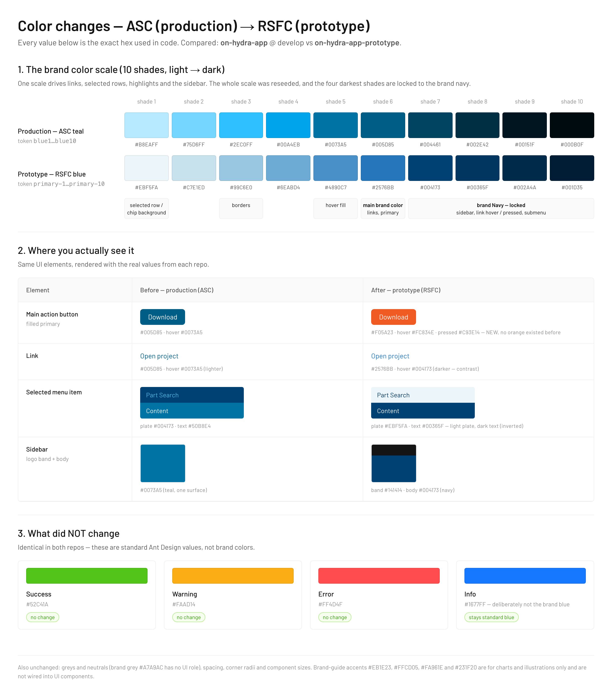
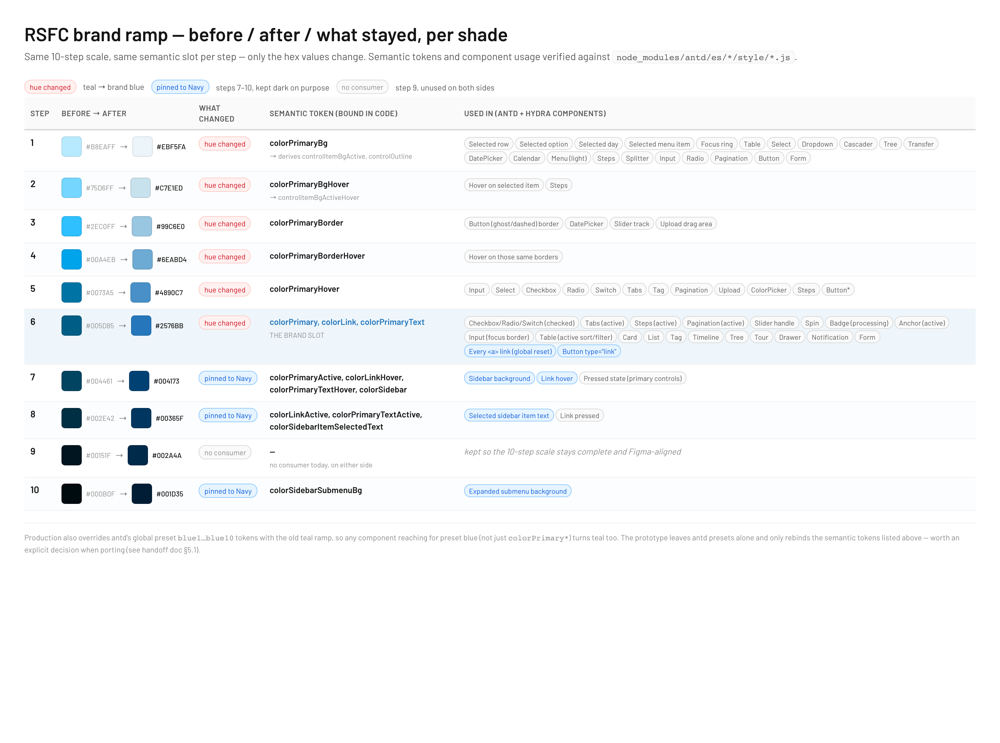

# RSFC rebrand — developer handoff

What changed visually between the **production app** and the **prototype**, in three areas: **logo**,
**typography**, **colors**. Written for a developer who has to port the rebrand into the real app and
has not followed the design discussion.

**Compared:**

| Side | Repo | Ref |
|---|---|---|
| Production app ("before") | [`ooden-tech/on-hydra-app`](https://github.com/ooden-tech/on-hydra-app) | `develop` @ `5037072` |
| Prototype ("after") | `ooden-tech/on-hydra-app-prototype` | `con-296-content-download-history` @ `4063521` + the uncommitted typography weight cleanup of 2026-09-17 |

**Scope:** brand identity only. Spacing, radii, control heights, and component layout metrics are *not*
covered here — do not assume the two repos agree on those just because this document is silent about them.

---

## 1. TL;DR — the whole rebrand in five lines

1. **Logo:** ASC "Engineered Solutions" lockup → **Reliable Safety & Flow Corporation (RSFC)**. Same
   cube mark geometry, recolored, new wordmark. PNG → SVG.
2. **Font:** **Cairo → Barlow**, one family for everything (body, headings, code). A third weight tier
   (Medium 500) was added.
3. **Primary color:** ASC teal **`#0073A5` / `#005D85` → RSFC blue `#2576BB`**, with brand Navy
   (`#004173`…`#001D35`) pinned on the dark end of the ramp so the sidebar stays navy.
4. **Solid primary buttons are orange** (`#F05A23`) — this is new. Ghost/link primary stays blue.
5. **Status colors, neutrals, and the antd Daybreak blue used by info alerts did not change.**

Everything else in this document is detail and the porting checklist.

---

## 2. Where the values live

The prototype keeps every brand literal in a small set of mirror files. Nothing brand-related is
hardcoded in screens (verified: zero `#rrggbb` literals in `src/**/*.tsx`).

| What | Prototype file | Production equivalent |
|---|---|---|
| Blue ramp (primary) | `src/theme/primaryPrimitiveBlue.ts` | `blue1`–`blue10` in `packages/on-hydra-ui/src/antd-theme/generated-theme.ts` |
| Orange ramp (buttons) | `src/theme/primaryPrimitiveOrange.ts` | — (does not exist) |
| Button primary palette | `src/theme/buttonPrimaryPalette.ts` | — (`components.Button` only clears shadows) |
| Sidebar / menu chrome | `src/theme/sidebarSemantics.ts`, `src/theme/hydraSemanticColors.ts` | `packages/on-hydra-ui/src/styles/root.scss` + `Menu`/`Layout` in `generated-theme.ts` |
| Typography metrics | `src/theme/hydraTypography.ts` → antd bridge `src/theme/hydraAntdTypography.ts` | `token.font*` / `token.lineHeight*` in `generated-theme.ts` |
| Webfont delivery | `index.html` (URL only) | `packages/on-hydra-ui/src/styles/root.scss` **and** `src/index.scss` (two `@import`s) |
| Logo assets | `public/assets/brand/rsfc-logo/{Mark,Wordmark}.svg` | `packages/on-hydra-ui/src/components/Logo/assets/*.png` |
| Logo composition | `src/shell/ConnectedSidebarBrand.tsx` + metrics in `src/theme/hydraMenuMetrics.ts` | `packages/on-hydra-ui/src/components/Logo/index.tsx` |

One structural difference worth knowing before you start: production reads its antd theme from
`getFigmaAntDConfig()` (the hand-maintained `generated-theme.ts`, ~2400 lines of flattened values) plus
CSS-variable layers consumed by SCSS modules. The prototype composes the theme from small typed modules.
**Porting means changing every layer in production** — the antd token object, the `colors` block, and the
generated CSS variables — or brand colors will only change in part of the UI. See §5.4 for how those
layers stack.

---

## 3. Logo


| | Production (ASC) | Prototype (RSFC) |
|---|---|---|
| Mark | Isometric cube, cyan + mid-blue + gray + black | **Same cube geometry**, recolored to `#2576BB` (blue) + `#A8AAAC` (gray) |
| Wordmark | "ASC" + "Engineered Solutions", black | "Reliable" + "Safety & Flow Corporation.", white (on navy) |
| Format | 4 PNGs: `logo.png`, `logo-white.png`, `small-logo.png`, `small-logo-white.png` | 2 SVGs: `Mark.svg` (27.84 × 27.96), `Wordmark.svg` (89.25 × 22.69) |
| Variants | `type: 'default' \| 'white'`, `size: 'medium' \| 'small'` | Mark + wordmark composed in a 120 × 29 box; collapsed sidebar renders the mark alone |
| Alt text | `alt="eCard"` (stale) | `aria-label="Reliable Safety & Flow Corporation"` |
| Product label | "ASC ConnectED™" (19 files, mostly backend email copy) | "**ConnectED**" beside the logo, `Title/Heading 5` / Barlow Medium |

Exact placement inside the 120 × 29 lockup (from `hydraMenuMetrics.ts`, mirrored from Figma):

```
mark:     left 0,      top 0,     27.84 × 27.96
wordmark: left 30.197, top 2.736, 89.25 × 22.69
brand band height: 62px (sidebar header row)
```

Expanded and collapsed sidebar as currently rendered:

| Expanded | Collapsed |
|---|---|
|  |  |

**To port:** swap the four PNGs for the two SVGs (or export PNG equivalents if you want to keep the
existing `<Logo>` API), fix the `alt`, and decide whether the product name becomes "ConnectED" or
"RSFC ConnectED™" — the prototype dropped the "ASC" prefix, and the backend email templates still say
"ASC ConnectED™". That naming decision is not a code question; get it confirmed before the port.

---

## 4. Typography

### 4.1 Family

| | Production | Prototype |
|---|---|---|
| Body | **Cairo** (`wght@200..1000`) | **Barlow** (`ital,wght@0,400;0,500;0,600;1,400`) |
| Headings | Cairo | Barlow (same family — no condensed variant) |
| Code (`fontFamilyCode`) | **Courier Prime** | Barlow (no separate code font) |
| Delivery | `@import` in **two** files (`styles/root.scss`, `src/index.scss`), plus `font-family: … Cairo` hardcoded **16 times across 7 SCSS modules** | Single `<link>` in `index.html`; every consumer reads `--hydra-font-family` / antd `token.fontFamily` |

> The prototype briefly used Barlow Condensed for headings and Courier Prime for code (commit `4063521`).
> Both were removed on 2026-09-17. **Ship Barlow only** — see the changelog in
> [`hydra-typography.md`](./hydra-typography.md).

### 4.2 Weights

Production has two tiers. The prototype has three; the middle one is the new part.

| Tier | Production | Prototype | Used by |
|---|---|---|---|
| Normal | 400 | 400 | body text, `Underline`, `Delete`, `Italic` |
| **Medium** | — | **500** | `Title/Heading 3-5`, `Subtitle/*`, and **every body `*/Strong` role** |
| Strong | 600 (`fontWeightStrong`) | 600 | `Title/Heading 1-2` only |

Practical consequence: `<Typography.Text strong>` renders at **500**, not 600, and H1/H2 are the only
text that still reaches 600. If you port the family but not the weights, headings will look heavier
than the designs.

### 4.3 Sizes and line heights — read this one carefully

Sizes agree on both sides (38 / 30 / 24 / 20 / 16 for headings; 12 / 14 / 16 / 20 for body). **Line
heights do not.** antd `lineHeight*` tokens are *unitless multipliers*, and the production values were
generated by dividing the intended pixel line height by **16** instead of by the role's own font size.
So the token is off by `fontSize / 16` for every role that isn't 16px:

| Role | Size | Design line height | Production token → renders as | Prototype token → renders as |
|---|---|---|---|---|
| `Small` | 12 | 20px | `1.25` → **15px** | `1.667` → 20px |
| `Base` | 14 | 22px | `1.375` → **19.25px** | `1.571` → 22px |
| `Large` | 16 | 24px | `1.5` → 24px ✓ | `1.5` → 24px ✓ |
| `Heading 5` | 16 | 24px | `1.5` → 24px ✓ | `1.5` → 24px ✓ |
| `Heading 4` | 20 | 28px | `1.75` → **35px** | `1.4` → 28px |
| `Heading 3` | 24 | 32px | `2.0` → **48px** | `1.333` → 32px |
| `Heading 2` | 30 | 38px | `2.375` → **71.25px** | `1.267` → 38px |
| `Heading 1` | 38 | 46px | `2.875` → **109.25px** | `1.211` → 46px |

Only the two 16px roles are correct today, because 16 is what everything was divided by. The prototype
computes the ratio per role (`unitlessLineHeight(lineHeight, fontSize)` in `hydraTypography.ts`), so the
rendered box always matches the design.

Expect visible vertical-rhythm shifts when you fix this — body text gains ~3px per line and headings
shrink a lot. It is a real change in layout, not a no-op, so plan a visual pass on dense screens
(tables, cards, drawers) rather than fixing it quietly alongside the font swap.

---

## 5. Colors



*Regenerate with `node scripts/brand-compare/render.mjs` after changing any value below.*

### 5.1 Primary ramp

Same slot, different hue. Production seeds a custom teal ramp; the prototype reseeds steps 1–6 from
`generate('#2576BB')` and **pins steps 7–10 to brand Navy** so sidebar surfaces keep resolving to navy.

| Step | Production (`blue*`) | Prototype (`Primary/primary-*`) | Role |
|---|---|---|---|
| 1 | `#B8EAFF` | `#EBF5FA` | `colorPrimaryBg` (selected rows, chips) |
| 2 | `#75D6FF` | `#C7E1ED` | `colorPrimaryBgHover` |
| 3 | `#2EC0FF` | `#99C6E0` | `colorPrimaryBorder` |
| 4 | `#00A4EB` | `#6EABD4` | `colorPrimaryBorderHover` |
| 5 | `#0073A5` | `#4890C7` | `colorPrimaryHover` |
| 6 | `#005D85` | **`#2576BB`** | **`colorPrimary`, `colorLink`** |
| 7 | `#004461` | `#004173` (Navy) | `colorPrimaryActive`, link hover, **sidebar background** |
| 8 | `#002E42` | `#00365F` (Navy) | link active, selected sidebar text |
| 9 | `#00151F` | `#002A4A` (Navy) | — |
| 10 | `#000B0F` | `#001D35` (Navy) | submenu background |

Two notes on the mapping:

- **Text and links darken on hover (7 → 8) while fills lighten (6 → 5).** That is deliberate: lightening
  link hover put it below WCAG AA on white, so hover moves into the Navy end.
- **Production overrides antd's preset `blue1`–`blue10` tokens**, so every antd component that reaches for
  preset blue also turns teal. The prototype leaves antd presets untouched and only sets the
  `colorPrimary*` / `colorLink*` semantics. Worth deciding explicitly during the port; keeping the preset
  override means the rebrand leaks into places you did not intend.

Dark-mode ramps exist on both sides (`bluePrimaryPrimitiveDark`) and were regenerated from the new seed.

### 5.2 Which semantic each shade feeds, and where that semantic surfaces



*Regenerate with `node scripts/brand-compare/render-ramp-full.mjs` after changing any value below. A
single-repo version (prototype only, no before/after) is at
`./assets/rsfc-rebrand-semantic-token-map.png`, `node scripts/brand-compare/render-semantic-map.mjs`.*

The ramp is never referenced by step number in UI code. Each step is bound to one antd semantic token
in `semanticsFromRamp()` (`primaryPrimitiveBlue.ts`), and antd then derives further aliases from those.
The "surfaces in" column lists the components that actually read the token — taken from
`node_modules/antd/es/*/style/*.js`, not from the antd docs. **What changed is only the hex per step —
the semantic slot and the components that read it are identical on both sides**, with steps 7–10
already pinned to Navy on the old side too (production simply used a less saturated Navy).

| Shade | Hex | Semantic token | Surfaces in |
|---|---|---|---|
| 1 | `#EBF5FA` | `colorPrimaryBg` → antd derives **`controlItemBgActive`** and **`controlOutline`** | **Selected state backgrounds:** `Table` selected row (`rowSelectedBg`), selected option in `Select` / `Dropdown` / `Cascader` / `Tree` / `Transfer`, selected day in `DatePicker` / `Calendar`, selected item in light `Menu`, `Steps`, `Splitter`. Also the **focus ring** (as an alpha blend) on `Input`, `Select`, `Radio`, `Pagination`, `Button`, `Form` |
| 2 | `#C7E1ED` | `colorPrimaryBgHover` → `controlItemBgActiveHover` | Hover over an item that is already selected; `Steps` |
| 3 | `#99C6E0` | `colorPrimaryBorder` | Borders of primary-colored, non-solid controls: `Button` (ghost / dashed), `DatePicker`, `Slider` track, `Upload` drag area |
| 4 | `#6EABD4` | `colorPrimaryBorderHover` | Hover state of those same borders |
| 5 | `#4890C7` | `colorPrimaryHover` | **Hover on form controls:** `Input`, `Select`, `Checkbox`, `Radio`, `Switch`, `Tabs`, `Tag`, `Pagination`, `Upload`, `ColorPicker`, `Steps` (and `Button`, but see §5.3) |
| 6 | **`#2576BB`** | `colorPrimary`, `colorLink`, `colorPrimaryText` | **The brand slot.** Checked `Checkbox` / `Radio` / `Switch`, active `Tabs` / `Steps` / `Pagination`, `Slider` handle, `Spin`, processing `Badge`, active `Anchor`, focused `Input` border, `Table` active sort/filter, plus `Card`, `List`, `Tag`, `Timeline`, `Tree`, `Tour`, `Drawer`, `Notification`, `Form` accents. `colorLink` styles **every `<a>`** (antd's global reset) and `Button type="link"` |
| 7 | `#004173` | `colorPrimaryActive`, `colorLinkHover`, `colorPrimaryTextHover`, `colorSidebar` | Pressed state of primary-colored controls; **link hover**; **sidebar background** (`Menu.darkItemBg`) |
| 8 | `#00365F` | `colorLinkActive`, `colorPrimaryTextActive`, `colorSidebarItemSelectedText` | Link pressed; **text of the selected sidebar item** (`Menu.darkItemSelectedColor`) |
| 9 | `#002A4A` | — | No consumer today; kept so the 10-step scale stays complete and Figma-aligned |
| 10 | `#001D35` | `colorSidebarSubmenuBg` | Expanded submenu background in the sidebar (`Menu.darkSubMenuItemBg`) |

Two things about this table that surprise people:

- **`colorPrimaryText*` has no antd consumer at all** (verified: zero hits in antd component styles). It
  exists for application code, and this repo uses it in 6 places for primary-colored text that is not a
  link. Changing it affects our screens only.
- **The single highest-traffic token is shade 1**, not shade 6 — through `controlItemBgActive` it paints
  every selected row, option and calendar day in the product. If a rebrand looks "not applied" after
  swapping `colorPrimary`, shade 1 is usually the one still missing.

Repo-side usage frequency (`token.*` references in `src/`): `colorPrimary` 68, `colorPrimaryBg` 24,
`colorPrimaryBorder` 12, `colorPrimaryBgSubtle` 8, `colorPrimaryBorderHover` 6, `colorPrimaryText` 6,
`colorLink` 4. `colorPrimaryHover` and `colorPrimaryBgHover` are never referenced directly — they only
reach the UI through antd's own component styles.

**Two Hydra-only extras** (not antd tokens, defined in `primaryPrimitiveBlue.ts`):
`colorPrimaryBgSubtle` (`#F6FAFC`, lighter than shade 1) and `colorPrimaryBorderSubtle` (`#EBF5FA`), used
for chips and mapped-column highlights where shade 1 was too saturated.

**Info is a separate scale.** `colorInfo*` binds to antd Daybreak Blue (`#1677FF` at shade 6), not to the
brand ramp, and surfaces in `Alert`, `Badge`, `message`, `Modal`, `notification`, `Progress` and `Result`.
That separation is deliberate: an info message should not read as a brand statement.

### 5.3 Solid primary buttons are orange — new

There is no orange ramp in production at all (`volcano` appears zero times). In the prototype:

| Token | Value | Step |
|---|---|---|
| `components.Button.colorPrimary` | **`#F05A23`** | `volcano-6` |
| hover | `#FC834E` | `volcano-5` |
| active | `#C93E14` | `volcano-8` |
| bg / bgHover | `#FFF6F0` / `#FFDFC9` | `volcano-1` / `volcano-2` |
| border / borderHover | `#FFC3A1` / `#FFA578` | `volcano-3` / `volcano-4` |

Scope: **`Button type="primary"` (solid) only.** Ghost, link, and text primary buttons stay blue via
`--hydra-brand-*` CSS variables. Files: `primaryPrimitiveOrange.ts`, `buttonPrimaryPalette.ts`, and the
`components.Button` block in `antdTheme.ts`.

### 5.4 Sidebar and app chrome

Production resolves sidebar colors through **three stacked layers**, which is the single most confusing
thing about this part of the port:

1. `styles/root.scss` — static `:root` values shipped as `styles.css` (`--on-dark-primary-color: #1F263E`).
2. `getColorsStyleDocument(themeConfig.colors)` — every app appends this `<style>` at boot
   (`apps/*/src/index.tsx`), which **overwrites the same variables** with the `colors` block of
   `generated-theme.ts` (`darkPrimaryColor: #0073A5`, `selectedMenuBgColor: #004173`, …).
3. The generated `--antd-figma-colors-*` variables plus the antd `Menu` / `Layout` component tokens.

So `#1F263E` is only a build-time fallback — **the effective sidebar background in a running app is the
ASC teal `#0073A5`**. If you only edit `root.scss`, nothing visible changes.

| Surface | Production (effective at runtime) | Prototype |
|---|---|---|
| Sidebar background | `#0073A5` via `--on-dark-primary-color` | `#004173` (`primary-7`, brand Navy) |
| Logo band | part of the sidebar | `#141414` (`Neutral/gray-12`), 62px tall |
| Selected item | bg `#004173`, light-blue text | bg `#EBF5FA` (`primary-1`), text `#00365F` (`primary-8`) |
| Dark `Menu` item bg / submenu | `#004173` / `#002E42` | `#004173` / `#001D35` (`primary-10`) |
| Menu item radius | `8` | `0` (square rows) |

The selected-item treatment inverts: production highlights with a darker navy plate and light text; the
prototype uses a near-white plate with navy text.

Note that production has two navigation implementations —
`common/navigation/components/Navigation` (reads `--on-dark-primary-color`) and
`common/layout/app-shell/AppShell*LeftNavigation` (reads the `--antd-figma-colors-*` family). Both need
the new values.

### 5.5 What did **not** change

Don't burn time on these:

- **Status colors** — `colorSuccess #52C41A`, `colorWarning #FAAD14`, `colorError #FF4D4F` are antd
  defaults on both sides.
- **Info blue** — the prototype maps `colorInfo*` to antd **Daybreak Blue** (`#1677FF`) so info alerts
  stay blue instead of adopting the brand hue. Production points `colorInfo` at its primary teal, so this
  is technically a change, but the intent is "info is not a brand color" — keep Daybreak.
- **Neutral ramp / grays** — unchanged; brand gray `#A7A9AC` has no UI role.
- **Brand sheet accents** `#EB1E23`, `#FFCD05`, `#FA961E`, near-black `#231F20` — scoped to charts and
  illustrations in the brand guide, "never used alone". They are **not** UI state colors. Do not wire them
  into components.

---

## 6. Porting checklist for `on-hydra-app`

Ordered so that each step is independently verifiable.

**Colors**
- [ ] Replace `blue1`–`blue10` in `packages/on-hydra-ui/src/antd-theme/generated-theme.ts` with the RSFC ramp; set `colorPrimary`/`colorLink` to `#2576BB`.
- [ ] Decide whether to keep overriding antd's preset `blue*` (see §5.1).
- [ ] Update the `colors` block at the top of `generated-theme.ts` — this is what actually reaches the browser via `getColorsStyleDocument()` (§5.4) — **and** the matching fallbacks in `packages/on-hydra-ui/src/styles/root.scss` (`--on-dark-primary-color`, `--on-link-color`, `--on-selected-menu-*`, `--on-popup-bg-color`).
- [ ] Update the generated `--antd-figma-colors-*` block (the `styles` key at the end of `generated-theme.ts`) — the SCSS modules read brand colors from there, not from the antd token object.
- [ ] Hunt hardcoded hexes. Current counts across `*.scss` / `*.ts` / `*.tsx`: `#0073a5` **76**, `#b8eaff` **36**, `#0591ff` **16**, `#004173` **11**, `#00a4eb` **9**, `#50b8e4` **2**, `#1f263e` **2**.
- [ ] Rename the `brand-asc-frontend-*` variable family (16 distinct names) if the ASC name is being retired.
- [ ] Add the Volcano ramp + `components.Button` primary palette for the orange solid button.

**Typography**
- [ ] Swap the Google Fonts `@import` in `styles/root.scss` and `src/index.scss` to `Barlow:ital,wght@0,400;0,500;0,600;1,400`.
- [ ] `token.fontFamily` and `token.fontFamilyCode` → `Barlow`; remove Courier Prime.
- [ ] Remove the 16 hardcoded `font-family: … Cairo` declarations across 7 SCSS modules, and the ones inside the CSS strings in the generated `styles` block.
- [ ] Introduce the 500 tier and move body `*/Strong` roles to it; keep 600 for H1/H2 only.
- [ ] Recompute every `lineHeight*` token against its own font size (§4.3), then do a visual pass on dense screens.

**Logo & naming**
- [ ] Add the RSFC SVGs; update `packages/on-hydra-ui/src/components/Logo/index.tsx` (and its story) for SVG + the collapsed mark-only case.
- [ ] Fix `alt="eCard"`.
- [ ] Replace the 4 `favicon.ico` files. `apps/on-hydra-frontend/index.html` also links a `manifest.json` that is not in the repo — find out where it is served from.
- [ ] Confirm the product name, then update the "ASC ConnectED™" strings (19 files, mostly backend templates).

---

## 7. Known loose ends

- **The prototype still says "ASC" in copy and seed data** (62 files — e.g. "ASC catalog", "ASC Master
  Spec", "ASC Engineer"). That is demo content, not theme, but it means "prototype = rebranded" is true
  for chrome and tokens, not for copy.
- **Figma `Compact` mode:** `lineHeightXL` should go 28 → 24. Agreed with design, not yet applied in
  Figma, and antd has no `lineHeightXL` token, so no repo change is needed.
- **`Subtitle/Extra Large`** exists in Figma but is not mirrored in code — no consumer yet.

## 8. Related documents

- [`hydra-typography.md`](./hydra-typography.md) — text-style roles, Figma variable bindings, full changelog
- [`hydra-tokenization-parity-audit.md`](./hydra-tokenization-parity-audit.md) — color token parity, brand-sheet decisions
- [`asc-to-rsfc-design-rebrand-audit.html`](./asc-to-rsfc-design-rebrand-audit.html) — designer-facing rebrand audit
- [`rsfc-rebrand-design-scope.html`](./rsfc-rebrand-design-scope.html) — rebrand scope as presented to design
