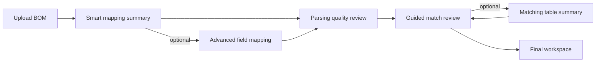

# BOM Flow Audit — Matt / Lucas Requirements (June 5, 2026)

**Date:** 2026-06-08  
**Updated:** 2026-06-08 (gap fixes applied in prototype)  
**Author:** Implementation audit vs prototype  
**Sources:**
- Meeting notes: *Product/Design - Weekly — 2026-06-05* (Matt Pettit, Lucas Saeed)
- PRD: *BOM Upload & Match Review Workflow*
- Repo PRD mirror: `docs/prd/bom-prd.md`
- Codebase: `src/bom/`

**Scope:** Full upload → mapping → parsing → match review → SKU selection → final workspace flow.

---

## Fixes applied (2026-06-08)

| Gap | Fix |
|-----|-----|
| Parsing edits not persisted | `BomParsingReviewPage` saves `parsedItems` + regenerated `matchResults` to import session on continue |
| Concatenated column edge case | `deriveFieldMappingForUpload` + filename pattern; description-only mapping with warning |
| Multi-candidate figures | `BomSuggestedPartsPicker` in progressive review |
| Orphan replacement picker | `BomReplacementPickerPage` redirects to guided review |
| Match detail gaps | Product URL, Skip/Next actions; exposed from matching table |
| Review card polish | Thumbnail + SKU variant count on progressive review |
| SKU picker | Variant count label + submittal link per variant |
| Workspace dashboard | KPI strip, status filter UI, imported-part column, swap via drawer |
| Copy / messaging | Smart mapping title, upload card copy, accurate import success count |

---

## Executive summary

The prototype **largely implements the architecture Matt and Lucas asked for**: smart mapping first (not a technical table by default), left-to-right mental model, non-blocking parsing warnings, guided progressive match review as the default, **“Choose”** instead of **“Refine”**, SKU-level selection, and a workspace that surfaces figure/SKU parent-child relationships.

**Main gaps** are prototype fidelity (seed/demo data, edits not persisting into matching), a few **orphaned legacy routes**, missing **edge-case handling** (single concatenated column, multiple figure candidates), and **UX polish** (product URLs, images on review cards, workspace KPI summary, keeping “swap part” inside BOM context).

| Area | Verdict |
|------|---------|
| Flow architecture | ✅ Aligned |
| Smart mapping + advanced layer | ✅ Mostly aligned |
| Parsing quality review | ✅ Aligned (demo wiring weak) |
| Guided match review | ✅ Aligned |
| Choose / missing match | ✅ Aligned |
| SKU-level selection | ⚠️ Partial |
| Final workspace dashboard | ⚠️ Partial |
| Demo / data persistence | ❌ Weak |

---

## Expected flow (Matt / Lucas / PRD)

**Core principles from the meeting:**
1. System maps automatically; user confirms — not a data-mapping expert.
2. Left-to-right: **uploaded BOM → ASC mapping/match**.
3. Warnings ≠ blockers (yellow/orange = heads-up, not “you’re stuck”).
4. No default spreadsheet edit mode — distinct CTAs per row.
5. No match → **Choose** (search / featured parts), not **Refine**.
6. Intermediate **progress-based review** between parsing and final import.
7. Match detail: image, metadata, product URL, PDF/submittal.
8. End goal: **SKU-level** selection, not only figure number.
9. Final dashboard: selected SKU + figure reference + submittal + original import (progressive disclosure).

---

## Route map (implemented)

| Step | Route | Screen |
|------|-------|--------|
| Hub / upload | `/bom/site/:constructionProjectId` | `BomSiteProjectsPage` |
| Smart mapping | `/bom/projects/:id/mapping-summary` | `BomMappingSummaryPage` |
| Advanced mapping | `/bom/projects/:id/field-mapping` | `BomFieldMappingPage` |
| Parsing review | `/bom/projects/:id/parsing-review` | `BomParsingReviewPage` |
| Match review (default) | `/bom/projects/:id/matching/review` | `BomProgressiveMatchingPage` |
| Match table (secondary) | `/bom/projects/:id/matching/table` | `BomMatchingPage` |
| Final dashboard | `/bom/projects/:id/workspace` | `BomWorkspacePage` |

**Legacy / orphaned (not in main PRD flow):**
- `/bom/projects/:id/matching/items/:itemId/replacement` — `BomReplacementPickerPage` (no inbound links)
- `/bom/projects/:id/items/:itemId/narrow` — `BomNarrowPage`
- `/bom/projects/:id/items/:itemId/recommend` — `BomRecommendPage`
- `/bom/search` — catalog search, outside BOM choose context

---

## Screen-by-screen audit

### 1. Upload & project entry (`BomSiteProjectsPage`)

#### ✅ OK
- Project list + upload destination (new vs append to existing).
- Post-upload navigates to **mapping summary**, not advanced mapping (`BomSiteProjectsPage` → `/mapping-summary`).
- 3-step upload chrome: Map Columns → Review Parsed Rows → Match parts.
- Resume in-progress uploads from workspace via `BomPendingUploadsRegion` + `routeForImportStep`.
- Workspace supports append re-upload with preserved back-navigation.

#### ⚠️ Could be better
- Upload card copy mentions “parsing review” but navigation goes to **mapping summary** first — copy mismatch.
- Upload is **simulated** (timeout + toast); no real parser or file-specific column detection.
- `location.state` carries flow context; full page refresh can lose unsaved step state (partial `localStorage` recovery only).

#### ❌ Missing / wrong
- No real upload progress tied to parsing/matching stages.
- Global BOM landing removed (`BomLandingPage` deleted); hub is construction-project scoped only — acceptable for prototype, different from PRD §6 wording.

---

### 2. Smart mapping summary (`BomMappingSummaryPage`)

#### ✅ OK
- **First screen after upload** — not the technical mapping grid (PRD Step 2).
- Auto-derived mapping from `DEFAULT_FIELD_MAPPING` / `resolveFieldMapping`.
- **Left-to-right summary:** YOUR BOM COLUMN → ASC FIELD.
- Confidence tiers: high / partial / blocked via `evaluateMappingConfidence`.
- Clear alerts: continue when OK, blocked when required fields missing or duplicates.
- Optional **“Review mapping”** → advanced view without forcing it.
- Cancel upload supported.

#### ⚠️ Could be better
- Confidence is **rule-based** (mapped count thresholds), not inferred from actual file headers.
- Summary shows mapped fields only — user may not see what was intentionally skipped.
- Page title still says **“Column mapping”** — slightly technical vs “smart mapping summary” language Matt asked for.

#### ❌ Missing / wrong
- **Single concatenated column → description** (PRD Edge Case 3) — **not implemented**. No detection in `bomFieldMappingUtils.ts`; always uses full 13-field demo mapping.
- No warning when only description is mapped that match accuracy may be lower.

---

### 3. Advanced field mapping (`BomFieldMappingPage`)

#### ✅ OK
- **Secondary layer** — reached via “Review mapping”; back returns to summary (PRD Step 3).
- **Left-to-right layout:** BOM column `Select` left, ASC field label right (`YOUR BOM COLUMN` / `ASC FIELD`).
- Duplicate + required field validation before save.
- Save continues to parsing review.

#### ⚠️ Could be better
- Still a **13-row mapping grid** — improved vs spreadsheet, but can feel like a form to complete.
- Rows are ASC-field-centric (one row per ASC destination), not “here are your uploaded columns” — acceptable but not identical to PRD mental model.

#### ❌ Missing / wrong
- No real column inference behind the selects (prototype limitation).

---

### 4. Parsing quality review (`BomParsingReviewPage`)

#### ✅ OK
- Quality strip: high / medium / low counts (PRD Step 4).
- **Non-blocking warning copy** matches PRD direction (`bomParsingReviewAlert.ts`):
  - *“Some rows may produce less accurate matches… you are not blocked.”*
- Low-confidence row highlighting (warning background).
- **Read-only table** + **“Add info” / “Edit” opens drawer** — avoids default spreadsheet editing (Matt/Lucas explicit ask).
- Actions: Continue with current data, Review low-confidence rows, filter toggle.
- Upload step chrome with plain-language status.

#### ⚠️ Could be better
- Still **table-shaped** with many columns — scanning-heavy for non-technical users.
- Medium-confidence rows less visually prominent than low (subtle fill vs yellow/orange bar Matt suggested).
- Row edits are **local state only** — not written to import session.

#### ❌ Missing / wrong
- **Parsing edits do not flow into matching.** `useBomMatchingData` always seeds from `createParsingReviewRows()` / session seed — edits on this screen don’t affect match review.
- No dynamic parsing based on uploaded file or mapping profile beyond column profile selection.

---

### 5. Guided progressive match review (`BomProgressiveMatchingPage`) — PRD Step 5

#### ✅ OK
- **Default matching experience** (`BomMatchingIndexRedirect` → `/matching/review`).
- Progress-based flow: “Reviewing N of M”, progress bar, remaining/skipped counts.
- **One item at a time**, original (left) vs suggested ASC (right).
- **Confirm / Skip / Choose** CTAs; auto-advance on confirm/skip.
- **“Choose” when no suggestion** — no “Refine” anywhere in `src/bom/`.
- **SKU required gate** before confirm (`isReadyToConfirmMatch`).
- Inline `BomSkuVariantPicker` for figure-level matches.
- Match detail drawer via “View details”.
- Skipped items surfaced before import (modal + warning).
- Import with skipped allowed — confirm modal, skipped excluded from workspace rows.
- Bulk “Confirm all high matches” for power users.
- Link to optional table view.

#### ⚠️ Could be better
- **No product image on main review card** — only in `BomMatchDetailDrawer`.
- Demo seeds items 1 & 5 as already `accepted` — queue may show fewer pending lines than expected in demos.
- **“Confirm all high”** auto-skips medium/low pending lines — aggressive vs “confirm one by one” emphasis in meeting.
- Import success message may overstate count vs rows actually added.

#### ❌ Missing / wrong
- **Multiple figure candidates** (PRD Edge Case 7) — `suggestedParts` exists in data but **no expand/collapse UI** in progressive review.
- Match detail drawer has no **Skip** or **Go to next part** actions (PRD §8).
- When user has no suggested match, match detail drawer returns null — choose uses separate drawer (OK, but detail pattern incomplete).

---

### 6. Matching table — secondary dashboard (`BomMatchingPage`)

#### ✅ OK
- Positioned as **“Optional table view”** with copy recommending guided review.
- KPI strip: total, accepted, pending, skipped, aggregate confidence.
- Filters: confidence level, skipped-only.
- Per-row: Choose / Choose different part / Select SKU / Confirm / Skip.
- **No “Refine”** label.
- “Finish review & import” disabled while `pending > 0` — routes back to guided review.

#### ⚠️ Could be better
- Still a **dense spreadsheet-style table** — OK as secondary view per Lucas (“use table as summary dashboard”), but heavy.
- `handleConfirm` relies on UI disabling Confirm when SKU needed — no server-side re-validation.
- Candidates column shows count only — no drill-down.

#### ❌ Missing / wrong
- Cannot complete import end-to-end from table alone — must visit progressive page (intentional gating, but easy to miss).

---

### 7. Choose part flow (`BomChoosePartDrawer`, `BomSearchPage`, `BomReplacementPickerPage`)

#### ✅ OK
- **Primary choose UX: drawer** inside match review — keeps user in BOM context (PRD preferred direction).
- **“Choose” / “Choose different part”** labeling correct (`bomMatchingColumns.tsx`).
- Featured category chips via `getBomChooseFeaturedProducts`.
- Search within ASC browser products; selection returns to review with `lineStatus: 'pending'` until confirmed.
- Manual selection sets `matchLevel: 'sku'`, `source: 'manual'`.

#### ⚠️ Could be better
- Featured parts are **3 category buttons**, not full catalog `FeaturedParts` integration.
- Drawer uses flat radio list — no product images.
- `BomSearchPage` redirects to `/catalog/results` — **outside BOM context**; not wired to match-review choose flow.

#### ❌ Missing / wrong
- **`BomReplacementPickerPage` is orphaned** — route exists but **no navigation** from matching/progressive/table. Dead alternate choose path vs drawer.
- Matt asked for featured parts to guide users toward mid-level categories when no match — partially met via chips, not full featured-parts experience.

---

### 8. SKU selection (`BomSkuVariantPicker`, `BomSkuVariantDrawer`, `bomMatchSkuUtils`)

#### ✅ OK
- Figure vs SKU model (`BomMatchLevel`, `matchRequiresSkuSelection`, `isReadyToConfirmMatch`).
- **Expand/collapse + radio list** under figure with variant metadata (size, finish, domestic/import, painted) — matches PRD §11 pattern.
- Used in progressive review (inline) and table (drawer).
- Confirm blocked until SKU selected.
- Demo seeds include figure-only matches for items 2 & 3.

#### ⚠️ Could be better
- Variant rows lack **images, submittal links, product URLs** per variant.
- No pagination/search inside large variant lists (PRD open question #6).
- No “N SKU variations” count surfaced on figure-level match card (Lucas suggested this in meeting).

#### ❌ Missing / wrong
- `BomNarrowPage` is a **legacy Q&A narrowing flow** — separate route, **not** the PRD SKU selection UI and not linked from main upload flow.

---

### 9. Match detail (`BomMatchDetailDrawer`)

#### ✅ OK
- Opens from progressive review “View details”.
- Image placeholder / `imageUrl`, figure reference, description, confidence + score %.
- Metadata: family, SKU/variant, dimensions, pressure, connection, approvals.
- **Submittal/PDF link** via `demoSubmittalUrlForFigure`.
- **Original imported part** section.
- Confirm match + Choose different part actions.

#### ⚠️ Could be better
- Not accessible from **table rows** directly.
- Unavailable when `topMatch` is null (no-suggestion rows).

#### ❌ Missing / wrong
- **Product URL** (PRD §8, §16) — **not shown**; only submittal link.
- **Related parts** — not present.
- No **Skip** or **Next part** in detail view (Matt described confirm → auto-advance flow from detail).

---

### 10. Final workspace dashboard (`BomWorkspacePage`)

#### ✅ OK
- Post-import destination from progressive `runImport`.
- Table shows **SKU/variant primary**, **figure as link** to ASC products.
- Quantity, match confidence, review status columns.
- **Submittal link** per row.
- **“Original” progressive disclosure** → `BomWorkspaceImportDetailDrawer`.
- Parent-child: SKU column + figure link + variant label.
- Pending upload resume strip; append-import banner for new lines needing review.

#### ⚠️ Could be better
- `statusFilter` in code but **no filter UI** in toolbar (only via append banner).
- `handleTranslateParts` implemented but no Translate button in main UI.
- Workspace resolve modal still form-heavy.
- Row double-click to review — undiscoverable.
- Swap/choose from workspace goes to **`BomAscProductsPage` full page** — leaves BOM context.

#### ❌ Missing / wrong
- **Not a summary dashboard with KPIs** — PRD §12 implies concise stat strip + table; matching page has KPIs, workspace does not.
- No distinct **competitor part number** column in primary table (original data only via drawer).
- Matt asked for parent figure link + submittal at SKU row — **partially met** (figure link + submittal yes; parent “family” visual weaker than content download-center pattern he referenced).

---

## Cross-cutting requirements

| Requirement (Matt / Lucas / PRD) | Status | Notes |
|----------------------------------|--------|-------|
| Auto column mapping | ✅ | Default mapping + summary screen |
| Smart summary before advanced mapping | ✅ | `BomMappingSummaryPage` first |
| Left-to-right: uploaded → ASC | ✅ | Mapping summary + field mapping + match review |
| Low-confidence rows = warning not blocker | ✅ | Parsing review + parsing alert copy |
| Avoid spreadsheet default editing | ✅ | Parsing review drawer; match review card-based |
| Distinct CTAs per row | ✅ | Choose, Confirm, Skip, Select SKU |
| “Choose” not “Refine” | ✅ | Grep: no “Refine” in `src/bom/` |
| Guided progress review (default) | ✅ | `BomProgressiveMatchingPage` |
| Match score visible at part level | ✅ | Tags + detail drawer |
| Match detail: image, PDF, metadata | ⚠️ | Missing product URL |
| SKU-level final selection | ⚠️ | UI exists; demo + table confirm edge cases |
| Final dashboard: figure + SKU + links | ⚠️ | Mostly there; no KPI strip |
| Original import metadata (progressive) | ✅ | Workspace drawer + parsing context |
| Skipped items tracked before import | ✅ | Stats, modal, filters |
| Import blocking if incomplete review | ⚠️ | **Open** — import allowed with warning (PRD Q1) |
| Featured parts for missing match | ⚠️ | Category chips, not full featured catalog |
| Multi-candidate figure selection | ❌ | Data exists, no UI |
| Single concatenated column handling | ❌ | Not implemented |
| Terminology / tooltips (figure vs SKU) | ⚠️ | Labels present; no industry glossary Matt offered |

---

## Priority gaps (recommended order)

1. **Wire parsing review edits → import session → matching** so user changes affect match results.
2. **Single-column / concatenated file detection** → map to description + accuracy warning on mapping summary.
3. **Multi-candidate figure UI** in progressive review (expand `suggestedParts`).
4. **Remove or link `BomReplacementPickerPage`** — avoid duplicate dead choose path.
5. **Match detail:** add product URL; expose from table; add Skip / Next part.
6. **Progressive review card:** show thumbnail image without opening drawer.
7. **Workspace:** KPI strip, status filter UI, prefer drawer for swap vs full-page ASC products.
8. **SKU variant rows:** submittal/image links; show variant count on figure-level matches.
9. **Copy pass:** upload card destination, mapping summary title tone, import success count.
10. **Decide import blocking rule** with Matt/James (block vs warn when rows skipped/unreviewed).

---

## Verdict vs Matt / Lucas intent

**The prototype delivers the redesigned flow architecture they asked for in the June 5 meeting.** A non-technical user can upload, see an auto-mapping summary, skim parsing quality with clear warnings, walk through parts one-by-one (or use the table as a secondary summary), choose parts when the algorithm has no suggestion, pick SKU variants when only a figure is matched, and land on a workspace that shows SKU + figure + submittal + original import on demand.

**What would not yet satisfy a production V1 review:**
- Demo/seed fidelity (edits don’t persist; always same sample rows).
- Missing PRD edge cases (concatenated column, multiple figure candidates).
- Orphan legacy screens that could confuse future work.
- Product URL and richer part verification in match detail.
- Workspace as a true “final dashboard” with summary KPIs, not only a table.
- Open product decision: hard-block import vs warn-and-continue.

**For Figma/client alignment:** The code path matches the PRD flow diagram closely enough to use as an internal functional prototype; Figma remains the primary client-facing artifact per team agreement.

---

## References

- `docs/prd/bom-prd.md`
- `docs/implementation-plans/bom-implementation-plan.md` (partially out of date vs current code)
- `src/bom/BomRoutes.tsx`
- Meeting transcript: *Product_Design - Weekly - 2026_06_05*
- Workflow PDF: *BOM Upload & Match Review Workflow*
