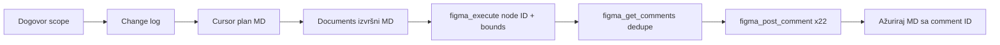

# Workflow: automatski komentari u Figmi (BOM Flow V3) — vodič + prompt za FigJam

**Svrha ovog dokumenta:** objašnjava **ceo proces** kako su komentari uspešno ubaceni u Figma dizajn fajl, koje su **MD datoteke** korišćene, koji **alati** i **pravila**, i daje **gotov prompt** za ChatGPT da napravi **tačan FigJam** (dijagram toka + swimlane po fazama).

**Realizovan primer:** sekcija **BOM Flow V3** u fajlu [BOM-SPEC — ASC Connected v2](https://www.figma.com/design/Ht3Up5MlRAKjK7eCuAy05L/BOM-SPEC---ASC-Connected-v2?node-id=5022-23065) — **22 komentara** na **8 ekrana**, 2026-05-28.

---

## 1. Šta smo postigli (rezultat)

| Metrika | Vrednost |
|---------|----------|
| Figma fajl | `Ht3Up5MlRAKjK7eCuAy05L` — BOM-SPEC — ASC Connected v2 |
| Sekcija | BOM Flow V3 — `5022:23065` |
| Ekrani sa komentarima | 8 (eksplicitna lista od korisnika) |
| Ukupno pinova | 22 |
| Format teksta | **What** + **Why** (engleski), bez **Does** |
| Automatizacija | Figma Console MCP (`user-figma-console`) |
| Comment ID opseg | `1779711005` – `1779711727` |

Komentari su **prikačeni na konkretne node-ove** (`node_id` + apsolutne canvas koordinate `x`, `y`), ne samo na nivou celog ekrana.

---

## 2. Inventar datoteka (šta je pravljeno i u kom redosledu)

### 2.1 Cursor pravila (izvor istine za agenta)

| Fajl | Uloga | Kada |
|------|-------|------|
| [`.cursor/rules/figma-console-mcp.mdc`](../../.cursor/rules/figma-console-mcp.mdc) | **Obavezno:** svi Figma zadaci idu preko **Figma Console MCP** (TJ Pitre), ne preko zvaničnog Figma plugin MCP-a | Uvek u repou |
| [`.cursor/rules/figma-layout-change-comments.mdc`](../../.cursor/rules/figma-layout-change-comments.mdc) | **Specifično za komentare:** šta pinovati, format What+Why, preskakanje ekrana/dugmadi, koordinate, redosled | Kada user traži annotate / komentare posle sync-a |
| [`.cursor/rules/figma-repo-to-screen-parity.mdc`](../../.cursor/rules/figma-repo-to-screen-parity.mdc) | Repo → Figma 1:1 (tipičan **izvor** promena koje se onda komentarišu) | Prethodni koraci u thread-u (layout sync) |
| [`.cursor/rules/figma-repo-parity.mdc`](../../.cursor/rules/figma-repo-parity.mdc) | Tokeni / DS autoritet (komentari **ne zamenjuju** parity dokumentaciju) | Referenca |

### 2.2 Plan u Cursor-u (radni plan sesije)

| Fajl | Uloga |
|------|-------|
| [`.cursor/plans/figma_bom_v3_comments_98c6f7ba.plan.md`](../../../.cursor/plans/figma_bom_v3_comments_98c6f7ba.plan.md) | **Operativni plan:** scope (8 ekrana), lista pinova po ekranu, linkovi na repo TSX fajlove, TBD node ID-jevi, todo koraci, procena ~22 komentara |

**Redosled korišćenja:** prvo se piše / ažurira **plan** → zatim **izvršni MD u Documents/** → zatim **post u Figmi**.

### 2.3 Izvršni MD u repou (deliverable za tim + izvršenje)

| Fajl | Uloga |
|------|-------|
| [`Documents/Bom/figma-bom-flow-v3-layout-comments-plan.md`](./figma-bom-flow-v3-layout-comments-plan.md) | **Kanonska tabela:** ekran → pin node → `node_id` → `x`/`y` → tekst komentara → **Figma comment ID** posle posta |

Ovaj fajl je **jedini izvor** za `figma_post_comment` pozive — agent ne pogađa node-ove van tabele.

### 2.4 Repo kod (kontekst za tekst komentara, ne za post)

Korišćen da se napiše smislen **Why** (product intent), ne za direktan API:

| Ekran | Repo fajl |
|-------|-----------|
| Workspace | `src/bom/pages/BomWorkspacePage.tsx` |
| Field Mapping | `src/bom/pages/BomFieldMappingPage.tsx` |
| Parsing ×3 | `src/bom/pages/BomParsingReviewPage.tsx`, `src/bom/bomParsingReviewColumns.tsx` |
| Matching Results | `src/bom/pages/BomMatchingPage.tsx` |
| Confirmed | isti matching flow, completed state |
| Replacement Picker | `src/bom/pages/BomReplacementPickerPage.tsx` |

### 2.5 Ovaj dokument

| Fajl | Uloga |
|------|-------|
| `Documents/Bom/figma-layout-comments-workflow-figjam-prompt.md` | **Meta-dokumentacija** + prompt za ChatGPT / FigJam |

---

## 3. Preduslovi (ljudski + tehnički)

1. **Figma Desktop** — ciljni fajl otvoren.
2. **Figma Console MCP — Desktop Bridge** plugin aktivan u tom fajlu.
3. **Cursor** sa MCP serverom `user-figma-console` (ne `plugin-figma-figma` za komentare).
4. **Scope dogovoren sa korisnikom:** sekcija + **tačna lista ekrana** (8 frame-ova), ne ceo fajl.
5. **Layout promene već urađene** (ili jasan change log šta je novo/izmenjeno u toj sesiji).

Provera konekcije: `figma_list_open_files`, `figma_navigate` na URL fajla.

---

## 4. End-to-end workflow (faze)



### Faza 0 — Scope (sa korisnikom)

- Figma **sekcija:** BOM Flow V3 `5022:23065`.
- **8 ekrana** (redosled korisnika):

| # | Ekran | Frame ID |
|---|--------|----------|
| 1 | Workspace / Main v2 | `5024:29217` |
| 2 | Field Mapping | `5022:23824` |
| 3 | Parsing / Has DESCRIPTION | `5022:23894` |
| 4 | Parsing / Has UPC | `5022:24115` |
| 5 | Parsing / Only SKU | `5022:24023` |
| 6 | Matching Results | `5026:21396` |
| 7 | Matching Results - Confirmed | `5026:21993` |
| 8 | Replacement Picker | `5026:90934` |

- **Commit range** za kontekst: `ad8ebf0` → `HEAD`.
- **Format komentara:** samo **What + Why** (bez Does).
- **Ne komentarisati** postojeća dugmad (Back, Approve, Continue, itd.).

### Faza 1 — Change log (tokom Figma/repo rada)

Za svaku stvarnu promenu u layout-u:

```
{ nodeId, nodeName, changeKind: 'added' | 'modified', oneLineSummary }
```

Komentari se pišu **samo** iz ovog loga — ne iz nagađanja.

### Faza 2 — Cursor plan (`.cursor/plans/...`)

Sadrži:

- tabelu 8 ekrana;
- po ekranu: pin node, Node ID (ili TBD), draft **What/Why**;
- link na repo TSX;
- todo listu: napiši MD → resolve TBD → dedupe → post → update MD;
- opcione parity stavke (npr. ukloni Candidates kolonu) — **odvojeno od komentara**.

### Faza 3 — Izvršni plan (`Documents/Bom/figma-bom-flow-v3-layout-comments-plan.md`)

Struktura **po ekranu**, jedna tabela:

| Kolona | Sadržaj |
|--------|---------|
| # | Redni broj (1–22) |
| Pin node | Ljudski naziv (npr. „KPI stat strip”) |
| Node ID | Figma format `5026:21422` |
| x, y | Apsolutne canvas koordinate (+8px inset) |
| Comment | `**What:** … **Why:** …` |
| Figma comment ID | Popunjava se posle posta |

**Pravilo:** ekran bez qualifying pinova → **nema sekcije u MD** i **nema postova** (nema „N/A” komentara).

### Faza 4 — Resolve node ID i koordinate (`figma_execute`)

Za svaki red gde je bilo **TBD**:

1. Skenirati decu frame-a (`5022:23832`, `5026:21994`, tabela/Alert po parsing varijanti, poslednja kolona u replacement tabeli).
2. Za svaki pin node učitati `absoluteBoundingBox` (ili `absoluteRenderBounds`).
3. Izračunati pin:
   - **Podrazumevano:** `x = bounds.x + 8`, `y = bounds.y + 8`
   - Široki table/alert: pin na header sublayer ako postoji
   - Mali kontrol: centar bounding box-a

**Rešeni TBD u BOM V3 primeru:**

| Element | Node ID |
|---------|---------|
| Mapping status panel | `5022:23888` |
| Import stepper (field mapping) | `5025:30159` |
| Parsing table/alert (×3 varijante) | `5022:23916` / `23914`, `24136` / `24134`, `24044` / `24042` |
| Confirmed import progress | `5026:22006` |
| Replacement Match Score kolona | `5026:91005` |

### Faza 5 — Dedupe (`figma_get_comments`)

- `fileUrl`: pun URL dizajn fajla.
- Proveriti da na istom `node_id` već **nije** aktivan komentar istog intenta.
- U BOM V3 slučaju: stari komentari bili na **drugim** node ID-jevima (legacy flow) — nema konflikta → slobodan post.

### Faza 6 — Post (`figma_post_comment`)

Za **svaki red** iz izvršnog MD-a:

```json
{
  "fileUrl": "https://www.figma.com/design/Ht3Up5MlRAKjK7eCuAy05L/BOM-SPEC---ASC-Connected-v2",
  "node_id": "5024:29236",
  "x": 46894,
  "y": -13911,
  "message": "**What:** … **Why:** …"
}
```

- Server: **`user-figma-console`**
- **Ne** koristiti zvanični Figma MCP za komentare.
- Batch: ~6 paralelnih poziva po grupi (22 ukupno).

### Faza 7 — Zatvaranje

- Upisati **Figma comment ID** u svaki red MD tabele.
- Sekcija **Execution** u MD (datum, 22/22, šta je preskočeno).
- Označiti todo u `.cursor/plans/...` kao completed.
- Kratki summary korisniku (broj pinova + koje oblasti).

**Opciono preskočeno u BOM V3:** vizuelni parity (Candidates kolona, Approve kao Button, stat card borders) — **nije** bilo u scope-u komentara.

---

## 5. Pravila šta pinovati (i šta ne)

### Pinovati ✅

| Kategorija | Primeri |
|------------|---------|
| Novi layout regioni | stat strip, import progress **kontejner**, nova kolona |
| Novi sadržaj | alert sa novom ulogom, filter, bulk akcija (region, ne dugme ako je staro) |
| Smislena izmena | zamenjen detached frame DS instancom, nova kolona Match Score |

### Ne pinovati ❌

| Kategorija | Primeri |
|------------|---------|
| Postojeća dugmad/linkovi | Back, Save and import, Cancel, Approve, Continue, Refine, pagination |
| Netaknuti DS instance | isti kao pre sesije |
| Čista vizuelna parity | samo token/border bez nove UX uloge |
| Ceo ekran bez promena | **preskoči ekran** — bez placeholder komentara |
| Shell | sidebar, global header (ako nije diran) |

### Format teksta

- **What:** tip elementa + naziv.
- **Why:** svrha na ekranu / u flow-u (može kratko ponašanje, ali **bez** labele Does).
- Present tense, engleski, bez „Changed from…”, „Previously…”, diff lista.
- ~2–4 rečenice ili dve označene linije u jednom pasusu.

**Dobar primer:**

> **What:** Manual swap context alert. **Why:** Identifies which part is being replaced and instructs the user to select a catalog row before approving the manual pick.

---

## 6. MCP alati (mapiranje)

| Korak | Alat | MCP server |
|-------|------|------------|
| Struktura / deca node-a | `figma_execute` | `user-figma-console` |
| Bounding box | `figma_execute` (čitanje `absoluteBoundingBox`) | isti |
| Lista komentara | `figma_get_comments` | isti |
| Post pin komentara | `figma_post_comment` | isti |
| Screenshot provera | `figma_capture_screenshot` (opciono) | isti |
| Navigacija fajl | `figma_navigate`, `figma_list_open_files` | isti |

**Ne koristiti za komentare:** `plugin-figma-figma` (`get_design_context`, `use_figma`, …).

---

## 7. BOM V3 — raspodela pinova po ekranu (za FigJam)

| Ekran | Broj pinova | Šta je objašnjeno |
|-------|-------------|-------------------|
| Workspace | 2 | Resume banner + progress |
| Field Mapping | 2 | Import strip step 1 + mapping status panel |
| Parsing ×3 | 6 | Tabela + alert po varijanti kolona |
| Matching Results | 8 | Progress step 3, KPI strip, filter, bulk accept, tabela, Status / Match score / Actions kolone |
| Confirmed | 1 | Import progress complete |
| Replacement Picker | 3 | Manual swap alert, katalog tabela, Match Score kolona |
| **Ukupno** | **22** | |

---

## 8. Prompt za ChatGPT — napravi FigJam od ovog workflow-a

Kopiraj blok ispod u ChatGPT (može uz prilog ovog MD fajla).

---

```
TI SI: dizajner procesa koji pravi FigJam board na osnovu dokumentovanog workflow-a za automatsko postavljanje Figma komentara (BOM Flow V3 primer).

CILJ: Jedan FigJam koji vizuelno objašnjava KAKO su komentari ubačeni u Figma dizajn fajl — od dogovora scope-a do 22 uspešna pina — tako da tim može da ponovi proces na drugom flow-u.

KONTEKST PROIZVODA:
- Hydra BOM import: upload → field mapping (step 1) → parsing review (step 2) → matching results (step 3) → workspace / replacement picker.
- Figma fajl: BOM-SPEC — ASC Connected v2, sekcija BOM Flow V3.
- 8 ekrana, 22 komentara, format What + Why (engleski).

OBAVEZNA STRUKTURA FIGJAM-a (levo → desno):

LANE 1 — "Ljudi & scope"
- Sticky: Korisnik definiše 8 ekrana + sekciju Figma
- Sticky: Pravila: What+Why, bez Does, ne pinovati postojeća dugmad
- Diamond: "Ima qualifying promene na ekranu?" → Ne → preskoči ekran (bez N/A komentara)

LANE 2 — "Dokumentacija (MD lanac)"
- Pravougaonik: `.cursor/rules/figma-console-mcp.mdc` (MCP izbor)
- Pravougaonik: `.cursor/rules/figma-layout-change-comments.mdc` (pravila pinova)
- Pravougaonik: `.cursor/plans/figma_bom_v3_comments_98c6f7ba.plan.md` (operativni plan)
- Pravougaonik: `Documents/Bom/figma-bom-flow-v3-layout-comments-plan.md` (izvršna tabela)
- Strelica: Plan → Izvršni MD → (popuna x,y, node ID)

LANE 3 — "Repo kontekst (opciono)"
- Mali boxovi: BomWorkspacePage, BomFieldMappingPage, BomParsingReviewPage, BomMatchingPage, BomReplacementPickerPage
- Napomena: samo za pisanje Why teksta, ne za API post

LANE 4 — "Figma Console MCP"
- Zahtev: Figma Desktop + Desktop Bridge
- Korak: `figma_execute` → resolve TBD node ID + absoluteBoundingBox (+8px)
- Korak: `figma_get_comments` → dedupe
- Korak: `figma_post_comment` × N (22 u primeru)
- Zabranjeno: zvanični plugin-figma-figma za komentare

LANE 5 — "Rezultat"
- Figma: 22 pina na node_id sa x,y
- MD ažuriran: Figma comment ID kolona
- Summary korisniku

DODATNI SWIMLANE "Šta pinovati" (donji deo board-a):
- Zeleno: novi regioni (stat strip, kolone, alert, progress kontejner)
- Crveno: NE pinovati (Back, Approve, Continue, sidebar, netaknuti elementi)

BOM V3 MINI-MAP (8 frame-ova kao mali pravougaonici u nizu):
1 Workspace (2) → 2 Field Mapping (2) → 3-5 Parsing×3 (6) → 6 Matching (8) → 7 Confirmed (1) → 8 Replacement (3)
Brojevi u zagradi = broj komentara.

STIL:
- Jasni naslovi sekcija, strelice sa labelama alata (figma_execute, figma_post_comment)
- Jedna legenda: What + Why format
- Datum primera: 2026-05-28, comment IDs 1779711005–1779711727

NE UKLJUČUJ:
- Opcioni parity koraci (Candidates kolona, Approve button) osim kao sivi "out of scope" box
- Tri-parčasti Does format
- Placeholder komentare na praznim ekranima

OUTPUT: Opis FigJam layouta sekciju po sekciju + predlog teksta na sticky notes + redosled konektora. Ako možeš generisati FigJam direktno, koristi gornju strukturu 1:1.
```

---

## 9. FigJam blueprint (vizuelna šema za ručno crtanje)

Ako ChatGPT ne generiše FigJam automatski, nacrtaj **5 horizontalnih zona**:

```
┌─────────────────────────────────────────────────────────────────────────────┐
│  ZONA A: START — Scope & pravila                                            │
│  [User: 8 screens] → [Rules MD] → {Qualifying change?} →|skip screen|       │
└─────────────────────────────────────────────────────────────────────────────┘
                                      ↓
┌─────────────────────────────────────────────────────────────────────────────┐
│  ZONA B: MD PIPELINE                                                        │
│  figma-console-mcp.mdc → figma-layout-change-comments.mdc                   │
│       → .cursor/plans/figma_bom_v3_comments…plan.md                         │
│       → Documents/Bom/figma-bom-flow-v3-layout-comments-plan.md             │
└─────────────────────────────────────────────────────────────────────────────┘
                                      ↓
┌─────────────────────────────────────────────────────────────────────────────┐
│  ZONA C: TEHNIKA (Figma Console MCP)                                        │
│  Desktop + Bridge → figma_execute (IDs + bounds) → figma_get_comments       │
│       → figma_post_comment (×22) → update MD with comment IDs               │
└─────────────────────────────────────────────────────────────────────────────┘
                                      ↓
┌─────────────────────────────────────────────────────────────────────────────┐
│  ZONA D: BOM V3 EKRANI (broj pinova)                                        │
│  [W:2]→[FM:2]→[P×3:6]→[MR:8]→[Conf:1]→[RP:3]  = 22 total                   │
└─────────────────────────────────────────────────────────────────────────────┘
                                      ↓
┌─────────────────────────────────────────────────────────────────────────────┐
│  ZONA E: PIN POLICY (sticky wall)                                             │
│  ✅ regions, columns, alerts, progress container                            │
│  ❌ pre-existing buttons, empty screens, shell, pure visual parity            │
└─────────────────────────────────────────────────────────────────────────────┘
```

**Boje (preporuka):**

- Plava: MD / dokumentacija
- Ljubičasta: MCP / automatizacija
- Zelena: uspešan rezultat u Figmi
- Crvena: zabrane (šta ne pinovati)
- Siva: out of scope (parity fixes)

---

## 10. Checklist za ponavljanje na drugom flow-u

- [ ] Dogovoren scope (sekcija + lista ekrana)
- [ ] Ažurirano `figma-layout-change-comments.mdc` ako treba nova pravila
- [ ] Napisan `.cursor/plans/<ime>-comments.plan.md`
- [ ] Napisan `Documents/.../<flow>-layout-comments-plan.md` sa tabelama
- [ ] Svi TBD node ID-jevi rešeni preko `figma_execute`
- [ ] x/y izračunati (+8px inset)
- [ ] `figma_get_comments` dedupe
- [ ] `figma_post_comment` samo za redove u planu
- [ ] MD dopunjen Figma comment ID kolonama
- [ ] Korisnik obavešten (broj pinova + ekrani)

---

## 11. Linkovi

| Resurs | URL / putanja |
|--------|----------------|
| Figma sekcija BOM Flow V3 | https://www.figma.com/design/Ht3Up5MlRAKjK7eCuAy05L/BOM-SPEC---ASC-Connected-v2?node-id=5022-23065 |
| Izvršni plan | `Documents/Bom/figma-bom-flow-v3-layout-comments-plan.md` |
| Cursor plan | `.cursor/plans/figma_bom_v3_comments_98c6f7ba.plan.md` |
| Figma Console MCP | https://github.com/southleft/figma-console-mcp |

---

*Poslednje ažuriranje: 2026-05-28 — BOM Flow V3, 22/22 komentara postovano.*
