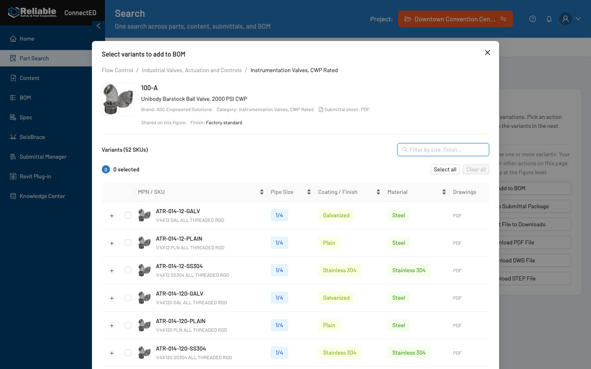

# Plan: Variant selection modal — sidebar summary, table-first layout

## Meta
- **Date:** 2026-11-03
- **Branch:** `feat/variant-modal-sidebar-layout` (cut from `part-listing`)
- **Request type:** `figma-delta` + `ui-change` (existing modal, Figma frames must follow the prototype)
- **User request summary:** Users must see and compare more SKU variants at once with less paging. Move the part summary and image into a compact left sidebar so the SKU table starts at the top of the modal (Lucas). Keep every behavior listed in §2 of the request. Applies to all four actions (Add to BOM, PDF, DWG, STEP). Update Figma frames afterwards and prepare a short before/after summary for Lucas. No Jira posting without Miloš's OK.
- **Status:** approved 2026-11-03 — Option A, error `Alert` for unavailable files, breadcrumb → Category tooltip
- **Plan file:** `Documents/plans/2026-11-03-variant-modal-sidebar-layout-plan.md`

## Orchestration for planning (this run)

### Explicit skills and rules used
| Name | Type | Path | Why selected |
|------|------|------|--------------|
| `@plan-orchestrator` | rule | `.cursor/rules/plan-orchestrator.mdc` | Requested; plan before code |
| `/impeccable` (layout principles) | skill | `~/.claude/skills/impeccable/SKILL.md`, `reference/layout.md` | Requested; spatial thesis, hierarchy, density. `shape` requires `PRODUCT.md` init — substituted with `layout` assessment because this is a narrow refinement inside the incumbent Ant Design/Hydra world (`SCOPED_EXISTING_ALLOWED`). Offer `/impeccable init` later. |
| `use-existing-components` | skill | `~/.claude/skills/use-existing-components/SKILL.md` | Requested; antd + tokens only |
| `@hydra-ux-audit` | skill | `.cursor/skills/hydra-ux-audit/SKILL.md` | Requested; quality gate before closing |
| `figma-design-to-code` | skill | Figma plugin skill | Mandatory before `get_design_context` |
| `@figma-use` | skill | `.cursor/skills/figma-use/SKILL.md` | Read-only Figma inspection now; frame edits in Phase 3 |
| `@figma-mcp-routing` | rule | `.cursor/rules/figma-mcp-routing.mdc` | Official MCP (`plugin-figma-figma`) |

### Implicit rules (always active)
| Invoke | Path | Why relevant to this task |
|--------|------|---------------------------|
| `@token-discipline` | `.cursor/rules/token-discipline.mdc` | One file changes; targeted reads |
| `@scope-guardrails` | `.cursor/rules/scope-guardrails.mdc` | Modal only; no shared edits |
| `@product-ux-rules` | `.cursor/rules/product-ux-rules.mdc` | Table = primary task; progressive disclosure for specs |
| `@ux-guardrails` | `.cursor/rules/ux-guardrails.mdc` | Reuse antd; one primary CTA |
| `@hydra-ui-tokens` | `.cursor/rules/hydra-ui-tokens.mdc` | No literals in TSX |
| `@hydra-ux-composition` | `.cursor/rules/hydra-ux-composition.mdc` | Sidebar composed from Flex/Typography/Collapse/Descriptions |
| `@figma-repo-parity` | `.cursor/rules/figma-repo-parity.mdc` | Figma frames must match the prototype |

### Not used (and why)
| Name | Why skipped |
|------|-------------|
| `@prd-ux-implementation-planner` | No PRD; requirements come from Lucas's direction in the request |
| `@ds-parity-auditor` | No token / theme changes |
| `@figma-console-mcp` | Not requested — Official MCP only |
| `impeccable shape` / `init` | Needs a `PRODUCT.md` interview; out of proportion for a single-modal refinement |

## Implementation invocation (use in a new chat after approval)

### Baseline — attach every UI implementation phase
```
@scope-guardrails
@token-discipline
@ux-guardrails
@hydra-ui-tokens-and-components
```

### Default attach set for this request type
```
@figma-use @figma-generate-design @hydra-design-to-code @hydra-ui-tokens-and-components @scope-guardrails @token-discipline @product-ux-rules
```

### Implicit rules during implementation
| Invoke | Path | Applies when |
|--------|------|--------------|
| `@hydra-ui-tokens` | `.cursor/rules/hydra-ui-tokens.mdc` | Every TSX edit |
| `@hydra-ux-composition` | `.cursor/rules/hydra-ux-composition.mdc` | Sidebar composition |
| `@figma-repo-parity` | `.cursor/rules/figma-repo-parity.mdc` | Phase 3 Figma update |

### Optional add-ons
| Invoke | Path | When to add |
|--------|------|-------------|
| `/impeccable layout`, `polish` | `~/.claude/skills/impeccable/` | Phase 1 build + Phase 2 verify (`impeccable detect --json`) |
| `@hydra-ux-audit` | `.cursor/skills/hydra-ux-audit/SKILL.md` | Phase 2 (mandatory before closing) |

## Scope summary
- **Route:** `/search/parts/:id` → Actions panel → Add to BOM / Download PDF / DWG / STEP File.
- **Component:** `src/search/components/VariantActionSelectionModal.tsx` (only caller: `src/search/components/ActionsPanel.tsx`, unchanged).
- **Test:** `tests/part-variant-selector.spec.ts` (p-200, p-300, BOM match picker).
- **Figma:** file `fyhH2NtH20puYbGLDChPwn`, page *Part Listing Flow* (`673:23362`), section *01 - Part listing* (`11024:16994`):

| Frame | Frame ID | Modal overlay instance |
|-------|----------|-----------------------|
| 01 — Part listing · Add to BOM | `11059:20915` | `11059:21102` |
| 01 — Part listing · Select variants for PDF download | `11059:23573` | `11059:24167` |
| 01 — Part listing · Select variants for DWG download | `11059:24699` | `11059:24855` |
| 01 — Part listing · Select variants for STEP download | `11024:17271` | `11024:17457` |

Out of scope: *Choose an action* (`11024:17010`) and *Add to Submittal Package* (`11059:22758` — a different modal that picks a package, not variants). Content File Manager untouched.

## Current flow audit

Measured on the running prototype (`/search/parts/p-100`, 52 SKUs), Playwright, current code:

| Viewport | Modal height | First table row from modal top | Fully visible rows | Footer CTA visible? |
|----------|--------------|-------------------------------|--------------------|---------------------|
| 1280×800 | 1056 | 392 px | 4 (STEP with warning: 3) | **No** — below the fold |
| 1440×900 | 1056 | 392 px | 6 (STEP with warning: 5) | **No** — below the fold |
| 1920×1080 | 1056 | 392 px | 8 (page cap = 8) | Yes |

Before screenshots: `Documents/plans/assets/2026-11-03-variant-modal/before-{bom,step}-{1280x800,1440x900,1920x1080}.png`



Findings:
1. **Summary stack eats ~37% of the modal** before the first row: breadcrumb → image + title + meta → “Shared on this figure” chips → divider → “Variants (N SKUs)” + search → selected count + Select all/Clear all → (warning) → table.
2. **Modal is taller than the viewport** at ≤1440×900. Pagination and the primary CTA (Add to BOM / Download …) require scrolling the overlay — the 5-second test fails for “what do I do next”.
3. **PAGE_SIZE = 8** is a hard cap; at 52 SKUs that is 7 pages. Repo standard for list tables is `shellLayout.tablePageSizeDefault` = 20.
4. Breadcrumb duplicates the page behind the modal and the “Category” meta line.
5. Toolbar uses two rows; the SKU count in the heading duplicates `showTotal` in pagination.
6. Search `Input` (default size) and Select all / Clear all (`size="small"`) sit in adjacent rows with mixed sizes.

Figma ↔ code drift already present (all four frames):

| Element | Figma | Code |
|---------|-------|------|
| Modal width | 1135 | `token.screenLG` = 992 |
| Unavailable-file warning | `Alert` (error), full width | `Typography.Text type="danger"` |
| Drawings column | `Tag__Colorful` (“PDF”, “STEP unavailable”) | secondary text + danger text |
| Header select-all checkbox | present | absent (Select all button instead) |
| Selected count | text only | `Badge` + text |

Phase 3 makes Figma follow the prototype. The Alert row is an open question below.

## Requirements / gap table
| Requirement | Current | Gap | UX risk | Area |
|-------------|---------|-----|---------|------|
| More SKU rows visible at desktop sizes | 4 / 6 / 8 rows | Summary stack above table | Low — layout only | Modal body |
| Table extends to the top of the modal | Starts at 392 px | Move summary to left sidebar | Low | Modal body |
| Compact part summary + image in sidebar | Full-width header | New local composition | Sidebar too tall → scrolls independently | Sidebar |
| Progressive disclosure for extra specs | Always-visible chips | Collapse, closed by default | User may miss shared specs → count in label | Sidebar |
| Less paging | 8 per page | 20 per page, scrollable table body | Long scroll inside page — sticky header keeps context | Table |
| All columns, filter, sort, expand, checkbox, Select all / Clear all, count | Present | Must not regress | — | Table / toolbar |
| Add to BOM confirm | Footer primary | Must stay visible without page scroll | Currently hidden below fold | Footer |
| STEP-unavailable warning + blocked submit | Present | Copy and logic unchanged | — | Toolbar |
| Works for BOM / PDF / DWG / STEP | One component | Verify all four | — | All |

## Proposed UX flow

**Spatial thesis (impeccable `layout`):** the variant table is the task; the part is context. Reading order left→right: *which part am I picking for* (sidebar, quiet) → *find and tick variants* (toolbar + table, dominant) → *confirm* (footer, always in view). Density stays at the catalog-table default; the gain comes from removing stacked chrome, not from squeezing rows.

### Recommended — Option A: sidebar + viewport-fit table

```
┌ Select variants to add to BOM ───────────────────────────────────── ✕ ┐
│ ┌ sidebar (256) ┐ ┌ main ─────────────────────────────────────────┐ │
│ │ [ image ]     │ │ [🔍 Filter by size, finish…      ] ●2 selected │ │
│ │ 100-A         │ │                        [Select all] [Clear all]│ │
│ │ Unibody Bar…  │ │ (Alert: 1 selected variation does not include  │ │
│ │ Brand · ASC   │ │  STEP. Remove it to continue.)   ← only if any │ │
│ │ Category · …ⓘ │ │ ┌ MPN / SKU ▾ │ Pipe size │ Finish │ … │ Drw ┐│ │
│ │ Submittal PDF │ │ │ rows … (sticky header, body scrolls)        ││ │
│ │ 52 variants   │ │ │                                             ││ │
│ │ ▸ Shared on   │ │ └─────────────────────────────────────────────┘│ │
│ │   all (4)     │ │              Showing 1–20 of 52 variants  ‹1 2 3›│ │
│ └───────────────┘ └───────────────────────────────────────────────┘ │
│                                              [Cancel] [Add to BOM]  │
└─────────────────────────────────────────────────────────────────────┘
```

- **Modal:** `width={token.screenXL}` (1200; closer to Figma 1135 and leaves the table ~900 px after the sidebar), `centered`, content capped at viewport height minus `token.marginXXL` top and bottom (`100vh` is the allowed structural value). Body is a flex column that fills the remaining height, so the footer is always on screen. Title, close, footer CTAs unchanged.
- **Sidebar** (`shellLayout.siderWidth` = 256, own vertical scroll if taller than the body, neutral surface `colorFillAlter` + `borderRadiusLG` or a `colorBorderSecondary` divider — pick the one matching `UnifiedPartDetailPage` inner panels):
  - Figure image, square, fills sidebar width; existing `PictureOutlined` placeholder when missing.
  - Figure number (`hydraLargeStrong`), product name (`hydraBaseNormal`, 2-line ellipsis with tooltip).
  - Meta lines (`hydraSmallNormal`, secondary): Brand, Category (leaf; full breadcrumb path in a `Tooltip`), Submittal sheet: PDF, “52 variants”.
  - **Shared specs:** `Collapse` (ghost, small), closed by default, label “Shared on all variants (N)”; panel is `Descriptions column={1} size="small"` with the current `headerSpecs` data. Hidden when N = 0.
- **Main column:**
  - **One toolbar row:** search `Input` (flex, existing placeholder + aria-label, keeps autofocus) · `Badge` + “N selected” · Select all · Clear all. All controls default size so heights match (fixes mixed sizes).
  - **Warning** (PDF/DWG/STEP, only when unavailable variants are selected): same copy, same blocking logic. Rendering: see open question 2.
  - **Table:** same columns, sorters, expandable row, checkbox column, carried-row highlight, empty text. `sticky` header, body scrolls inside the available height (measured locally with a `ResizeObserver` on the table wrapper — no new shared hook). Pagination stays, `pageSize = shellLayout.tablePageSizeDefault` (20), same `showTotal` (“Showing 1–20 of 52 variants”, which carries the SKU count the old heading showed).
- **Narrow viewports (< `screenLG`, via `Grid.useBreakpoint()`):** sidebar collapses into a compact strip above the toolbar (small image + figure number + name + Collapse), table keeps the rest.
- **Focus / keyboard order:** DOM order = visual order: Close → sidebar (Collapse header) → search (auto-focused on open, so the task starts there) → Select all / Clear all → table (sort headers, expand, checkboxes) → pagination → Cancel → primary.

**Expected result (estimate, verify in Phase 2):**

| Viewport | Before rows | After rows (est.) | CTA visible |
|----------|-------------|-------------------|-------------|
| 1280×800 | 4 | ~6 | Yes |
| 1440×900 | 6 | ~8 | Yes |
| 1920×1080 | 8 (cap) | ~10–11 | Yes |

Pages for 52 SKUs: 7 → 3.

### Alternatives considered
- **Option B — sidebar only, keep modal auto-height and 8 per page.** Smallest diff, table starts at the top, but the modal still overflows at 1440×900 and paging is unchanged. Doesn’t meet “less paging”.
- **Option C — no sidebar; collapsible summary strip on top** (one line: thumbnail · 100-A · name · “Details ▸”). Gives the table full width, but departs from Lucas's explicit direction (left sidebar).

## Implementation plan by phase

### Phase 1 — Prototype layout (code)
- **Goal:** Option A in the modal; zero behavior change.
- **Files:** `src/search/components/VariantActionSelectionModal.tsx` only.
- **UI changes:** as described in Option A.
- **Data/state:** none new beyond a local measured table-body height. `pendingKeys`, `carriedKeys`, `onSessionKeysChange`, eligibility and `unavailableSelectedCount` logic untouched. `PAGE_SIZE` constant replaced by `shellLayout.tablePageSizeDefault`.
- **Acceptance criteria:** all §2 behaviors still work; no raw hex/px/rgba; typography only via `hydraTypography` roles; imports from `src/ui/antd.ts`.
- **Must not change:** `ActionsPanel.tsx`, `variantSelectionShared.ts`, `variantDistinguishingAttributes.ts`, `HydraTag`, `catalogBrowseTableStyles`, theme files, BOM `BomSkuVariantModal`, Content File Manager.

#### Phase 1 — invoke for implementation
```
@scope-guardrails @token-discipline @ux-guardrails @hydra-ui-tokens-and-components @product-ux-rules @hydra-ux-composition
/impeccable layout   (read reference/craft-floor.md before the edit)
use-existing-components
```

**Copy-paste prompt:**
```
Implement Phase 1 only from this plan: Documents/plans/2026-11-03-variant-modal-sidebar-layout-plan.md

@scope-guardrails @token-discipline @ux-guardrails @hydra-ui-tokens-and-components @product-ux-rules @hydra-ux-composition
/impeccable layout · use-existing-components

Allowed files:
- src/search/components/VariantActionSelectionModal.tsx

Forbidden:
- Any other src/ file, theme files, shared components, tests, Content File Manager
```

### Phase 2 — Verify and audit
- **Goal:** prove more rows + no regressions for all four actions.
- **Files:** none in `src/` (fixes only in the Phase 1 file if the audit finds P0/P1). After screenshots in `Documents/plans/assets/2026-11-03-variant-modal/after-*.png`.
- **Steps:** `npx tsc --noEmit` · `npm run build` · ReadLints · `npx playwright test tests/part-variant-selector.spec.ts` · Playwright row count + screenshots at 1280×800 / 1440×900 / 1920×1080 for BOM and STEP-with-warning, plus PDF and DWG at 1440×900 · keyboard tab pass · `impeccable detect --json` on the file · `@hydra-ux-audit` Phase 1 report.
- **Acceptance criteria:** spec passes; ≥ 2 more fully visible rows at 1440×900; footer CTA visible at 1280×800 and up; audit verdict ✅ or only P2.

#### Phase 2 — invoke for implementation
```
@hydra-ux-audit @scope-guardrails @token-discipline
```

**Copy-paste prompt:**
```
Run Phase 2 from: Documents/plans/2026-11-03-variant-modal-sidebar-layout-plan.md

@hydra-ux-audit @scope-guardrails @token-discipline

Allowed files:
- src/search/components/VariantActionSelectionModal.tsx (audit fixes only)
- Documents/plans/assets/2026-11-03-variant-modal/*

Forbidden:
- Other src/ files, tests (must pass unchanged)
```

### Phase 3 — Figma frames follow the prototype
- **On hold (2026-11-03):** test the layout in the repo first. The production frames are unchanged; the original BOM modal was restored. The BOM draft lives in the section "Drafts — Variant modal sidebar layout (not approved)", frame `11275:3760`.
- **2026-11-04:** BOM draft completed to match the prototype: modal 1200 × (frame − 2 × `marginXXL`), 12 DS table rows (expand + checkbox Row Controls, colorful tags for Pipe Size / Coating / Material), Pagination "Showing 1–20 of 52 variants", Badge bound to `colorPrimary`. Screenshot: `assets/2026-11-03-variant-modal/figma-draft-bom.png`. Production frames (BOM, PDF, DWG, STEP) are still untouched.
- **Goal:** the four modal frames match the new layout, built from Hydra Ant Design – DS instances and variables only.
- **Nodes:** overlays `11059:21102` (BOM), `11059:24167` (PDF), `11059:24855` (DWG), `11024:17457` (STEP). Rebuild the modal slot content as a horizontal auto-layout: Sidebar (256) + Main column; reuse the existing Table cell / header / Pagination / Input / Button instances by moving them; add DS `Collapse` and `Alert` (STEP) instances found via `search_design_system`. Modal height = frame height − 2 × `marginXXL`, with as many rows as fit (matches the prototype at the same frame size). Resolve the drift table rows toward code.
- **Validation:** `get_screenshot` of each modal vs the 1920×1080 after screenshot (max 3 iterations); no raw fills (bind variables), text styles applied.
- **Must not change:** *Choose an action*, *Add to Submittal Package*, page chrome outside the overlays, DS library.

#### Phase 3 — invoke for implementation
```
@figma-use @figma-generate-design @figma-mcp-routing @figma-repo-parity @scope-guardrails
```

**Copy-paste prompt:**
```
Run Phase 3 from: Documents/plans/2026-11-03-variant-modal-sidebar-layout-plan.md

@figma-use @figma-generate-design @figma-mcp-routing @figma-repo-parity @scope-guardrails

Figma: https://www.figma.com/design/fyhH2NtH20puYbGLDChPwn/Part-Search-RSFC?node-id=11059-20915
Overlays: 11059:21102 (BOM), 11059:24167 (PDF), 11059:24855 (DWG), 11024:17457 (STEP)

Forbidden:
- Other frames in section 11024:16994, DS library edits, new variables/components
```

### Phase 4 — Before/after summary for Lucas
- **Goal:** short Markdown summary with before/after screenshots, row-count table, what stayed identical, and Figma links.
- **Files:** `Documents/plans/2026-11-03-variant-modal-sidebar-layout-summary.md`.
- **Must not:** post to Jira or Figma comments without Miloš's OK.

#### Phase 4 — invoke for implementation
```
@token-discipline
```

**Copy-paste prompt:**
```
Write Phase 4 summary from: Documents/plans/2026-11-03-variant-modal-sidebar-layout-plan.md
Do not post to Jira.
```

## File change plan
| File | Action | Reason |
|------|--------|--------|
| `src/search/components/VariantActionSelectionModal.tsx` | Edit | Layout change (Phase 1, audit fixes Phase 2) |
| `Documents/plans/assets/2026-11-03-variant-modal/*.png` | Add | Before (done) / after screenshots |
| `Documents/plans/2026-11-03-variant-modal-sidebar-layout-summary.md` | Add | Lucas summary (Phase 4) |
| Figma file `fyhH2NtH20puYbGLDChPwn` — 4 overlays | Edit | Phase 3 |

## Guardrails
- **Allowed (after approval):** files above; local helper components inside the modal file.
- **Forbidden:** shared components, `src/theme/*`, tokens, `ActionsPanel.tsx`, tests, Content File Manager, Jira posts, new icon sources.
- **Assumptions:** antd 6.3.5 `Table` `sticky` + `scroll.y` and `Modal` `styles` slots are available; `shellLayout.siderWidth` and `tablePageSizeDefault` may be reused outside the shell (they are exported layout metrics, not shell-only).
- **Decisions (2026-11-03, Miloš):**
  1. **Layout:** Option A.
  2. **Unavailable-file warning:** `Alert type="error" showIcon`, same copy and blocking logic (matches Figma STEP frame).
  3. **Breadcrumb:** dropped; full path as a `Tooltip` on the sidebar Category line.

## Risks
- `scroll.y` needs a measured height; a bad measurement can show a double scrollbar. Mitigation: measure the wrapper with `ResizeObserver`, verify at three viewports.
- Narrower table (≈ 900 px) with 4 distinguishing columns + Drawings: SKU names may ellipsize sooner. Ellipsis already in place; verify with p-100.
- Playwright browser build mismatch on this machine (repo expects chromium 1243; cache has 1234/1248). Phase 2 may need `npx playwright install chromium`.
- Figma overlays are component instances with a slot; rebuilding slot content must not detach the modal instance.

## Acceptance checklist
- [ ] ≥ 2 more fully visible SKU rows at 1440×900 (before: 6)
- [ ] Footer CTA visible without scrolling at 1280×800, 1440×900, 1920×1080
- [ ] All existing columns, filtering, sorting, row expand, checkboxes, Select all / Clear all, selected count unchanged
- [ ] Add to BOM confirm flow unchanged
- [ ] STEP-unavailable warning and blocked submit unchanged; PDF / DWG / STEP / BOM all verified
- [ ] `tests/part-variant-selector.spec.ts` passes
- [ ] `tsc`, build, lints clean; no raw values
- [ ] `@hydra-ux-audit` ✅ (focus order, tokens, typography, sizes, functionality)
- [ ] Four Figma overlays updated and screenshot-verified
- [ ] Lucas summary written; nothing posted to Jira

## Full implementation prompt (all approved phases)
```
Implement approved phase(s) from: Documents/plans/2026-11-03-variant-modal-sidebar-layout-plan.md

@scope-guardrails @token-discipline @ux-guardrails @hydra-ui-tokens-and-components @product-ux-rules @hydra-ux-composition @hydra-ux-audit @figma-use @figma-generate-design @figma-repo-parity
/impeccable layout · use-existing-components

Follow allowed files and guardrails in the plan. Do not expand scope. Do not post to Jira.
```

## Addendum 2026-11-04 — two options for Matt and the devs to pick from

**Source:** Lucas (Slack, 2026-11-03): "re-design like I showed that modal to you, or a simpler version that just shrinks the top part and shows more of the table (Matt wanted the easiest for devs). Maybe you can do both and let them pick." Reference modal: BOM – RSFC → `1.4 - Part Match Details · Match Found` (`Ht3Up5MlRAKjK7eCuAy05L`, node `6497:60402`).

Both options keep everything in "Must stay": columns, filter, sort, expand, checkboxes, Select all / Clear all, count, Add to BOM confirm, the STEP-unavailable `Alert`, all four actions, the viewport-fit table body with 20 rows per page, and the single-row toolbar.

### Option A — "Part details" column (Lucas's Part Match Details pattern)
- Replaces the grey sidebar card with a plain left column, a vertical `Divider`, and the table on the right.
- **Left column**, mapped from Lucas's `left-column` (`6497:60488`):

  | Figma | Code |
  |---|---|
  | width 280 | `shellLayout.siderWidth` (256). No 280 token exists, so this is a documented approximation. |
  | gap / paddingBlock 16 | `token.padding` |
  | heading Base/Medium | `hydraBaseStrong` (Medium weight) |
  | `info-row`: paddingBlock 12, bottom border `colorBorderSecondary` (none on the last row) | `token.paddingSM`, `token.lineWidth` solid `token.colorBorderSecondary` |
  | label Small/Normal, `colorTextLabel`, width 90 | `hydraSmallNormal`, `token.colorTextLabel`, label column `token.sizeUnit * 22` (88), the nearest token-derived width |
  | value Small/Normal, `colorText`, flex 1 | `hydraSmallNormal`, `token.colorText` |

- **Content:**
  - The square image, bordered with no card surface.
  - A heading with the figure number, then the product name.
  - Label/value rows: Brand, Category (Tooltip with the full path), Submittal sheet, Variants.
  - "Shared on this figure (N)" `Collapse` underneath, whose body uses the same rows.

### Option B — "Compact header" (simplest for devs)
- Keeps today's stacked structure: summary on top, table below.
- Shrinks the top part to one compact strip:
  - A small bordered image at `token.sizeXXL` (48; the old header used 80).
  - Line 1: figure number + product name.
  - Line 2: Small/Normal meta, Brand · Category (Tooltip) · Submittal sheet PDF · N SKUs.
  - Shared specs as a collapsed `Collapse` on the right of the strip.
- No breadcrumb row, no divider, no separate "Variants (N SKUs)" row, and one toolbar row, all the same as the current version.
- The table spans the full modal width.

### How reviewers switch
- A URL query parameter read only inside `VariantActionSelectionModal.tsx` (open question Q1).
- No production UI is added for switching.

### Scope
- Code: `src/search/components/VariantActionSelectionModal.tsx` only.
- Figma: drafts in the "Drafts" section only (BOM first), after repo approval.

### Open question
- **Q1:** which option is the default, and what are the parameter values?

### Figma (2026-11-04, built at Miloš's request before any repo change)
- Section "Drafts — Variant modal options (not approved)" (`11275:3759`). Nothing deleted; unused layers in the copies are hidden.
- Option A, Part details column: `11282:4634`. Screenshot: `assets/2026-11-03-variant-modal/figma-option-a-part-details-column.png`.
- Option B, Compact header: `11282:4930`. Screenshot: `assets/2026-11-03-variant-modal/figma-option-b-compact-header.png`.
- Previous sidebar-card draft kept: `11275:3760`. Production frames untouched.

### Table cell pattern, aligned with production (2026-11-04)
Checked `ooden-tech/on-hydra-app` (`develop`, `310125b`) across all frontends:
- **Attribute values** (Pipe Size, Coating / Finish, Material) render as plain text in every table: `PartPage/VariantPicker`, BOM parsing review, BOM "Your part" panel and match modal. The only colored tag is the attribute *label* in `PartPage/DistinguishingAttributes`, which is a list, not a table.
- **File formats** render as `Tag` everywhere, but with three different color maps:

| Source | PDF | DWG | STEP | RFA |
|---|---|---|---|---|
| `constants/part-variant-files.ts` (Part page "File types" column, VariantDownload popup) | cyan | green | blue | purple |
| `PartPage/VariantPicker/index.module.scss` (raw hex) | purple | brand orange | primary | — |
| Content File Manager `fileTableRows.ts` (CON-228) | red | orange | green | blue |

- Drafts now use plain-text attributes and the Part page map (`Tag__Colorful` cyan for PDF), per Miloš. Our prototype's `AttributeValueTag` columns and plain-text Drawings column differ from production; mirroring this in the repo is pending approval.
- Open question for Lucas / Matt: unify the three format color maps (and replace the VariantPicker raw hex with tokens).

### Expanded SKU row (2026-11-04, Figma Console at Miloš's request)
Frame "Part listing - Add to BOM - Option A: Expanded Row" (`11297:13200`), row ATR-014-12-PLAIN, panel `11297:14927`. Mirrors production `VariantPicker` `renderExpandedRow`:
- Row control switched to `type=collapse`.
- Panel: `colorFillQuaternary` (antd `colorFillAlter` value), bottom border `colorBorderSecondary` / `lineWidth`, left accent `colorPrimary`.
- Content starts under the MPN / SKU column; padding `paddingSM` / `paddingXS`, gap `marginXXS`.
- "SKU …" in Large/Medium + `colorText`; description in Base/Normal + `colorTextDescription`.
- "Label: value" items wrap with `padding` gap; label `colorTextDescription`, value `colorText`. Items: Configuration, Length, Connection type, Documents. Columns already in the table (Pipe Size, Coating, Material) are omitted, as in production.
- Last two rows hidden so the table still fits the modal.
- **Token gap:** production accent is 2px (antd `lineWidthBold`); the DS library publishes no 2px line-width variable, so the Figma accent is bound to `lineWidth` (1px).
