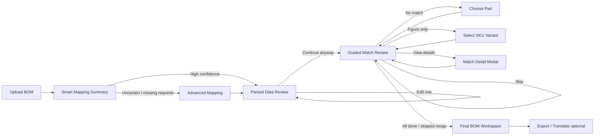

# BOM Upload & Match Review — Implementation Plan

**Date:** 2026-06-08  
**Source PRD:** [`docs/prd/bom-prd.md`](../prd/bom-prd.md)  
**Planner skill:** `prd-ux-implementation-planner`  
**Status:** Plan only — no code changes yet

---

## 1. Scope Summary

### In scope

BOM upload → smart mapping → parsed data review → match review → SKU selection → final workspace dashboard. All work stays under `src/bom/*` plus BOM-specific context hooks already wired in the app shell.

### Files inspected (targeted)

| Area | Files |
|------|--------|
| **Routes** | `src/bom/BomRoutes.tsx` |
| **Pages** | `BomSiteProjectsPage`, `BomFieldMappingPage`, `BomParsingReviewPage`, `BomMatchingPage`, `BomProgressiveMatchingPage`, `BomReplacementPickerPage`, `BomWorkspacePage`, `BomAscProductsPage`, `BomNarrowPage`, `BomRecommendPage`, `BomSearchPage`, `BomExportPage`, `BomTranslatePage` |
| **Layout / chrome** | `BomLayout`, `BomPageHeader`, `BomUploadFlowStepChrome`, `BomUploadProgressBar`, `BomImportProgressStrip`, `BomPendingUploadsRegion` |
| **State / flow** | `bomUploadFlowState.ts`, `bomImportProgressState.ts`, `BomImportFlowContext.tsx`, `BomWorkspaceContext.tsx` |
| **Hooks** | `useBomMatchingData.ts`, `useBomImportSession.ts`, `useBomCancelUpload.tsx` |
| **Utils / columns** | `bomFieldMappingUtils.ts`, `bomParsingReviewAlert.ts`, `bomParsingReviewColumns.tsx`, `bomMatchingColumns.tsx`, `bomMatchingBulkActions.ts`, `bomWorkspaceHelpers.ts` |
| **Data** | `data/types.ts`, `data/mockData.ts`, `data/bomImportFlowSeed.ts`, `data/bomWorkspaceSeed.ts`, `data/ascBrowserProducts.ts` |
| **Components** | `BomTags`, `PartTranslationModal`, `AscProductsDrawer`, `BomEditProjectModal` |

### Out of scope

- Content File Manager
- `src/shell/*`, `src/theme/*`, shared `ui/antd` barrel (unless a safe prop is unavoidable)
- Backend parsing/matching algorithms
- Full Figma V3 diff-only sync (`Documents/Bom/2026-06-08-bom-figma-v3-sync-plan.md` — separate track)

### Existing patterns to reuse

- Upload step chrome: `BomUploadFlowStepChrome` + `BomUploadProgressBar` (3 steps today)
- Import session persistence: `BomImportFlowContext` + `bomImportProgressState.ts`
- Progressive one-by-one review: `BomProgressiveMatchingPage` (exists, under-linked)
- Parsing warnings: `figmaParsingReviewAlert` + `parsingReviewFieldNeedsAttention`
- Replacement picker: `BomReplacementPickerPage` + `BomAscProductsPage`
- Workspace final table: `BomWorkspacePage` (figure + SKU columns already present)
- Catalog featured parts: `src/catalog/FeaturedParts.tsx` (reference pattern for Choose flow)

---

## 2. Current Flow Audit

### Screen-by-screen

| Step | Route | Purpose today | User action | Data shown | UX issue vs PRD | Key file |
|------|-------|---------------|-------------|------------|-----------------|----------|
| **0 — BOM hub** | `/bom/site/:id` | List BOM projects; upload new file | Upload file → destination modal → field mapping | Project table, status filters | OK entry point; no post-upload smart summary | `BomSiteProjectsPage.tsx` |
| **1 — Field mapping** | `/bom/projects/:id/field-mapping` | Manual column mapping (default first step after upload) | Map 13 ASC fields to BOM columns; Save & continue | Full mapping table; badge “N of 13 fields mapped” | **Technical default** — not smart summary; column order is **ASC field left / BOM column right** (PRD wants uploaded data leading); no confidence tiers | `BomFieldMappingPage.tsx` |
| **2 — Parsing review** | `/bom/projects/:id/parsing-review` | Review parsed rows before matching | Edit cells inline; Continue to matching | Editable table; alert for low/medium confidence rows | **Spreadsheet-like** default; warnings exist but row editing dominates; no dedicated “continue anyway” vs “edit row details” split | `BomParsingReviewPage.tsx`, `bomParsingReviewColumns.tsx` |
| **3a — Matching (table)** | `/bom/projects/:id/matching` | Dense results dashboard (default matching step) | Accept / Skip / Refine per row; bulk accept high; Save and import | KPI strip + filterable table; match score tags | **Default is dense table**, not guided review; **Save and import** allowed without reviewing all lines; “Refine” label when match exists | `BomMatchingPage.tsx`, `bomMatchingColumns.tsx` |
| **3b — Matching (progressive)** | `/bom/projects/:id/matching/progressive` | One-by-one guided review | Approve & next / Skip / Manual pick | Progress card; original vs suggested panels | **Exists but orphaned** — no link from table view or upload flow; blocks import while queue pending; no part detail modal; no SKU variant step; CTA says “Manual pick” not “Choose” | `BomProgressiveMatchingPage.tsx` |
| **3c — Choose / replace** | `/bom/projects/:id/matching/items/:itemId/replacement` | Catalog table picker | Select row → Approve | ASC browser products table | “Choose” only when no `topMatch` in table actions; picker is flat catalog **without featured parts**; full page leaves review context | `BomReplacementPickerPage.tsx` |
| **3d — Legacy narrow** | `/bom/projects/:id/items/:itemId/narrow`, `/recommend` | Guided Q&A narrowing | Answer questions → recommendations | Mock questions | **Not wired** into upload flow; parallel legacy path | `BomNarrowPage.tsx`, `BomRecommendPage.tsx` |
| **4 — Workspace (final)** | `/bom/projects/:id/workspace` | Post-import BOM dashboard | Edit qty inline; Review modal; manual swap via asc-products | Table: Part, Figure Number, SKU, Qty | Figure + SKU columns exist; **missing** match confidence, review status, submittal/PDF links, progressive “view original import”; inline qty editing feels spreadsheet-like | `BomWorkspacePage.tsx` |
| **Post-import** | `/translate`, `/export`, `/service-request` | Translation, export, service | Various | Workspace rows | Out of PRD V1 core path | respective pages |

### Data flow (current)

```
Upload (SiteProjectsPage)
  → location.state { uploadFileName, fieldMapping?, uploadId? }
  → FieldMappingPage (aliasMap saved to state)
  → ParsingReviewPage (local row edits; seeds from createParsingReviewRows)
  → MatchingPage (useBomMatchingData → session.matchResults in localStorage)
  → WorkspacePage (accepted rows via manual navigate OR progressive handleSaveAndImport)
```

**Gaps in data model:**

- `AscCatalogPart` / `BomMatchResult` have no `matchLevel` (figure-only vs SKU-level vs none)
- No `SkuVariant` list under a figure number
- No `productUrl`, `submittalUrl` on match/workspace rows
- `BomItem` has `figureNumber` + `sku` on parsed side but match results use `partNumber` as opaque ASC id

### Upload flow steps (chrome)

`BomUploadProgressBar` defines: **Map Columns → Review Parsed Rows → Match parts**. No distinct step for smart mapping summary, SKU selection, or guided review.

---

## 3. PRD vs Current Gap Table

| PRD requirement | Current support | Gap | UX risk | Implementation area |
|-----------------|-----------------|-----|---------|---------------------|
| Smart mapping summary after upload | Partial — auto `DEFAULT_ALIAS` on field mapping page only | No summary screen; user lands in full mapping table | Users feel like data experts on day one | New summary page or first panel on `BomFieldMappingPage`; route from `BomSiteProjectsPage` |
| Auto-derive column mappings | Partial — static defaults | No confidence scoring; no uncertain/partial states | False sense of precision or unnecessary refinement | `bomFieldMappingUtils.ts`, seed/mock inference, summary UI |
| Advanced mapping only when needed | Missing | Mapping table is always step 1 | Cognitive overload | Progressive disclosure link from summary → existing mapping table |
| Left-to-right: uploaded BOM → ASC field | **Inverted** on field mapping (ASC left, BOM right) | PRD mental model violated | Users read system fields first | `BomFieldMappingPage.tsx` layout swap |
| Single concatenated column → description | Missing | No detection or warning | Low match accuracy surprise | Mapping inference + summary copy |
| Row quality feedback before matching | Partial — parsing review alert + cell highlights | Table-first; warnings can read as blockers | Users stall on yellow rows | `bomParsingReviewAlert.ts`, parsing review layout |
| Guided match review (progress-based) | Partial — `BomProgressiveMatchingPage` exists | **Not default**; table is primary | Dense spreadsheet review | Route default to progressive; table as “View all” |
| Confirm / skip / choose different | Partial | Progressive has Approve/Skip/Manual pick; table has Accept/Skip/Refine | Label inconsistency (“Refine”, “Manual pick”) | `bomMatchingColumns.tsx`, progressive page CTAs |
| Auto-advance on confirm | Partial | Progressive advances; table does not | Table flow feels manual | Keep progressive as primary |
| Skipped items before final import | Partial | Progressive tracks skips; table allows import anytime | Incomplete BOM imported silently | Import gate + skipped recap screen/modal |
| Matched part detail view | Partial — workspace `PartTranslationModal` / resolve modal | **Not in match review flow**; no image, URL, PDF in progressive view | Users cannot verify matches confidently | New `BomMatchDetailModal` or extend progressive card |
| “Choose” when no match (not “Refine”) | Partial | Table uses “Choose” only when no `topMatch`; progressive uses “Manual pick”; accepted rows still say “Refine” | Misleading affordances | Rename CTAs per PRD |
| Choose → search / featured parts | Partial — replacement picker + asc-products | No featured parts; search exits BOM (`/catalog/results`) | Context loss | Embed featured parts in picker; prefer drawer/modal |
| SKU-level final selection | **Missing** | No figure→variant model or UI | BOM stops at figure/part number | New variant picker component + data types |
| Multiple figure candidates | Partial — `suggestedParts[]` count column | No expand/collapse candidate review | User cannot pick among figures | Progressive + table candidate UI |
| Final dashboard: figure + SKU + status | Partial — workspace columns | Missing confidence, review status, links, original metadata | Hard to audit import | `BomWorkspacePage.tsx` columns + row actions |
| Original import metadata (progressive disclosure) | Partial — resolve modal shows original line | Not on workspace rows by default | Loses traceability | Row menu / tooltip on workspace |
| Import blocking until all reviewed | **Inconsistent** | Table: no block; Progressive: blocks if pending | Confusing rules | Align on one rule (see open questions) |
| System first, user confirms | Partial | Auto defaults exist but UI exposes technical steps first | PRD principles not met | Phases 1–4 reorder and simplify |

---

## 4. Proposed UX Flow



### Step intent (non-technical language)

1. **Upload** — “We received your file.”
2. **Smart mapping summary** — “Here’s what we understood from your columns. Looks good?”
3. **Advanced mapping** (optional) — “Adjust only if something looks wrong.”
4. **Parsed data review** — “Some rows may match less accurately. You can fix them or continue.”
5. **Guided match review** — “Reviewing 3 of 30 parts — confirm each ASC match.”
6. **Choose part** (when needed) — “Pick the right ASC part from categories or search.”
7. **SKU selection** (when needed) — “Pick the exact size/finish variant under this figure number.”
8. **Final workspace** — “Your imported BOM with figure numbers, SKUs, and status.”

### Default vs advanced surfaces

| PRD surface | Default route | Advanced / escape hatch |
|-------------|---------------|-------------------------|
| Mapping | New summary (`/field-mapping` index or `/mapping-summary`) | Existing full table (`/field-mapping/advanced` or same page collapsed) |
| Parsing review | Summary alert + low-confidence row list | “View all rows” table (current table, de-emphasized) |
| Match review | `/matching/progressive` (redirect `/matching` → progressive) | `/matching` table view |
| Choose part | Drawer/modal with featured parts + search | Full-page `BomReplacementPickerPage` fallback |
| SKU pick | Inline expand under suggested figure | — |

---

## 5. Implementation Plan by Phase

### Phase 1 — Flow entry & smart mapping summary

**Goal:** After upload, users see a plain-language mapping summary—not a 13-row technical table.

**UI changes**

- Add smart mapping summary view (mapped pairs, confidence badge, primary CTA “Continue”, secondary “Review mapping”).
- Re-route upload from `BomSiteProjectsPage` to summary first.
- Swap field mapping column order: **Your BOM column (left) → ASC field (right)**.

**State/data**

- Add `mappingConfidence: 'high' | 'partial' | 'blocked'` to upload flow state (derived from alias map + required fields).
- Persist summary outcome in `BomUploadFlowLocationState`.

**Files**

- `BomSiteProjectsPage.tsx` (navigation target)
- `BomFieldMappingPage.tsx` or new `BomMappingSummaryPage.tsx`
- `bomUploadFlowState.ts`, `bomFieldMappingUtils.ts`
- `BomRoutes.tsx` (if new route)
- `BomUploadProgressBar.tsx` (optional step label tweak)

**Acceptance**

- Recognizable columns → summary with auto map + Continue without opening advanced table.
- Required fields missing → summary blocks Continue, prompts refinement.

**Must not change:** Workspace, catalog shell, theme tokens.

**Risks:** Figma V3 field mapping frame may need Console sync after layout swap.

---

### Phase 2 — Mapping intelligence & edge cases

**Goal:** Handle partial confidence and single-column uploads per PRD edge cases 1–3.

**UI changes**

- Summary shows uncertain columns list; non-blocking continue when allowed.
- Single detected column → default to Description with accuracy warning.

**State/data**

- `inferFieldMapping(fileMeta)` helper (mock for prototype).
- Concatenated-column flag on session.

**Files**

- `bomFieldMappingUtils.ts`
- `data/bomImportFlowSeed.ts` (demo scenarios)
- Summary + `BomFieldMappingPage.tsx`

**Acceptance**

- Single-column demo maps to description with warning.
- Partial mapping shows warning; user can continue if non-blocking.

---

### Phase 3 — Parsed data quality review (de-spreadsheet)

**Goal:** Parsing review explains row quality without feeling like mandatory data entry.

**UI changes**

- Lead with alert + counts (high / medium / low quality).
- Primary CTAs: “Continue with current data”, “Review low-confidence rows”.
- Move inline cell editing behind row detail drawer or “Edit row” action.
- Ensure warning copy states **non-blocking** explicitly.

**Files**

- `BomParsingReviewPage.tsx`
- `bomParsingReviewAlert.ts`
- `bomParsingReviewColumns.tsx` (reduce default editable surface)

**Acceptance**

- Low-confidence rows highlighted; user can continue.
- Copy matches PRD direction (accuracy may be lower, not blocked).

---

### Phase 4 — Guided match review as default

**Goal:** Match review is progress-based one-by-one flow; table is secondary.

**UI changes**

- `/matching` redirects to `/matching/progressive` (or progressive renders at `/matching` with table toggle).
- Rename CTAs: “Choose” (no match), “Choose different part” (has match); remove “Refine” / “Manual pick” in upload flow.
- Add skipped-items recap before import (modal or inline card).
- Align import gate: block or warn when pending/skipped (per product decision).

**Files**

- `BomMatchingPage.tsx`, `BomProgressiveMatchingPage.tsx`
- `bomMatchingColumns.tsx`
- `bomImportProgressState.ts` (step labels)

**Acceptance**

- User sees “Reviewing N of M parts” on entering match step.
- Confirm advances to next item.
- Skipped count visible before import.

---

### Phase 5 — Match detail & Choose experience

**Goal:** Users can open rich ASC part context and pick replacements without leaving BOM.

**UI changes**

- Match detail modal/drawer: image, metadata, product URL, PDF/submittal, match score, original import snippet.
- Choose flow: featured parts strip + categorized browse (reuse catalog patterns); prefer drawer over full page.
- Wire from progressive + table actions.

**Files**

- New local `BomMatchDetailModal.tsx` (composition only — no new shared DS components)
- `BomReplacementPickerPage.tsx` or new `BomChoosePartDrawer.tsx`
- `BomProgressiveMatchingPage.tsx`
- Reference: `src/catalog/FeaturedParts.tsx`, `FeaturedPartCard.tsx`

**Acceptance**

- Detail view available from guided review.
- No-match row shows “Choose”; selection returns to review queue.

---

### Phase 6 — SKU-level selection

**Goal:** Figure-level matches require explicit variant selection before confirm.

**UI changes**

- When `matchLevel === 'figure'`, show figure header + expandable SKU list with differentiating metadata.
- When multiple figure candidates, expand/collapse candidate cards then SKU step.
- Final workspace row stores selected SKU + parent figure link.

**State/data**

- Extend types: `BomMatchLevel`, `AscSkuVariant`, `selectedVariantId` on `BomMatchResult` / workspace `BomItem`.
- Seed demo rows: figure-only, multi-candidate, direct SKU match.

**Files**

- `data/types.ts`, `data/bomImportFlowSeed.ts`, `data/ascBrowserProducts.ts`
- New local `BomSkuVariantPicker.tsx`
- `BomProgressiveMatchingPage.tsx`, `buildWorkspaceRowFromMatch` in progressive page
- `bomWorkspaceHelpers.ts`, `bomWorkspaceSeed.ts`

**Acceptance**

- Figure-only match cannot be confirmed until SKU selected.
- Final dashboard shows selected SKU with figure as reference/link.

---

### Phase 7 — Final BOM dashboard enhancements

**Goal:** Workspace table matches PRD §12–13.

**UI changes**

- Columns: original reference, ASC figure (link), SKU/variant, qty, match confidence/status.
- Row actions: view original import metadata (tooltip/menu), submittal/PDF link.
- De-emphasize inline qty edit (or move to row detail).

**Files**

- `BomWorkspacePage.tsx`
- `bomWorkspaceHelpers.ts`, `data/bomWorkspaceSeed.ts`

**Acceptance**

- Parent-child relationship clear without clutter.
- Original metadata available via progressive disclosure only.

---

## 6. File Change Plan

### Allowed to change (by phase)

| Phase | Files |
|-------|--------|
| 1 | `BomSiteProjectsPage.tsx`, `BomFieldMappingPage.tsx`, `BomRoutes.tsx`, `bomUploadFlowState.ts`, `bomFieldMappingUtils.ts`, `BomUploadProgressBar.tsx` |
| 2 | `bomFieldMappingUtils.ts`, `bomImportFlowSeed.ts`, mapping summary page |
| 3 | `BomParsingReviewPage.tsx`, `bomParsingReviewAlert.ts`, `bomParsingReviewColumns.tsx` |
| 4 | `BomMatchingPage.tsx`, `BomProgressiveMatchingPage.tsx`, `bomMatchingColumns.tsx`, `bomMatchingBulkActions.ts`, `bomImportProgressState.ts` |
| 5 | `BomReplacementPickerPage.tsx`, new `BomMatchDetailModal.tsx`, optional `BomChoosePartDrawer.tsx`, `BomProgressiveMatchingPage.tsx` |
| 6 | `data/types.ts`, `bomImportFlowSeed.ts`, `ascBrowserProducts.ts`, new `BomSkuVariantPicker.tsx`, progressive + workspace builders |
| 7 | `BomWorkspacePage.tsx`, `bomWorkspaceHelpers.ts`, `bomWorkspaceSeed.ts` |

### Do not change

- `src/shell/*` (except if BOM provider already mounted — no structural shell edits)
- `src/theme/*`, `src/ui/antd.ts`
- Content File Manager modules
- `BomNarrowPage` / `BomRecommendPage` unless explicitly deprecating (leave untouched in V1)
- Shared catalog components (import/reference only)

### New files (expected)

- `src/bom/pages/BomMappingSummaryPage.tsx` (or equivalent section in field mapping)
- `src/bom/components/BomMatchDetailModal.tsx`
- `src/bom/components/BomSkuVariantPicker.tsx`
- `src/bom/components/BomChoosePartDrawer.tsx` (optional if drawer chosen)

---

## 7. Risks & Open Questions

### Risks

| Risk | Mitigation |
|------|------------|
| Figma V3 frames assume table-first matching | Sync with Console MCP after Phase 4; see `Documents/Bom/2026-06-08-bom-figma-v3-sync-plan.md` |
| Two matching UIs diverge | Single `useBomMatchingData` source; progressive as canonical |
| SKU data not in mock catalog | Extend `ascBrowserProducts` with variant groups for demo |
| Import gate inconsistency confuses users | Resolve open Q1 before Phase 4 |
| Scope creep into catalog navigation | Keep Choose inside BOM drawer; link out only as fallback |

### Open questions (from PRD §18 — need product confirmation)

1. **Block import until all rows reviewed?** — Table currently allows anytime; progressive blocks pending. Recommend: warn + recap; block only if required fields/SKU missing.
2. **Import only reviewed rows when some skipped?** — Progressive imports accepted + manual only today.
3. **Choose UI: modal, drawer, or full page?** — Recommend drawer with featured parts (PRD preference).
4. **Terminology** (figure, SKU, variant, parent, child) — Validate with James before final copy.
5. **Low-confidence row editing** — Recommend focused row detail, not inline spreadsheet.
6. **SKU variant list size** — Pagination/search inside expand if >10 variants.
7. **Match score display** — Current: label tag; PRD allows label + score metadata in detail view.
8. **Required fields before save** — Today: Part Number, Description, Qty on mapping.
9. **Featured parts** — Show on Choose only, or also on “choose different part”?
10. **Original data on dashboard** — PRD recommends progressive disclosure only (not default columns).

### Assumptions

- Prototype continues with mock data / localStorage sessions.
- Matching algorithm output will eventually expose `matchLevel` and `variants[]`; we mock shapes now.
- Existing `BomUploadFlowStepChrome` 3-step model remains unless Figma adds a fourth visible step.

---

## 8. Acceptance Criteria Checklist

### Smart mapping

- [ ] Upload with recognizable columns → auto map + summary screen
- [ ] High confidence → Continue without advanced mapping
- [ ] Missing required mapping → blocked with refine prompt
- [ ] Single concatenated column → maps to description + warning

### Low-confidence rows

- [ ] Insufficient-data rows visually highlighted at parsing review
- [ ] UI explains lower match accuracy (not a blocker)
- [ ] Continue preserves warning state into matching

### Match review

- [ ] Guided progress flow is default entry after parsing review
- [ ] Confirm advances to next part
- [ ] Skipped items surfaced before final import
- [ ] Detail view shows image, metadata, URL, PDF, score when available

### Missing matches

- [ ] No suggestion → CTA reads “Choose”
- [ ] Choose opens search/browse with featured parts
- [ ] Selection returns to review flow

### SKU selection

- [ ] SKU-level match → variant visible and confirmable
- [ ] Figure-only match → user guided to pick SKU
- [ ] Multiple variants → expand list with differentiating metadata
- [ ] Final dashboard shows selected SKU

### Final dashboard

- [ ] Table shows figure number, SKU/variant, quantity, review/confidence status
- [ ] Figure number link and submittal/PDF accessible
- [ ] Original import metadata via progressive disclosure

### Guardrails

- [ ] Content File Manager untouched
- [ ] Shared components/tokens unchanged
- [ ] Changes limited to `src/bom/*` (+ local new components)
- [ ] Each phase independently testable in demo

---

## Implementation order recommendation

Execute **Phases 1 → 4** first (highest PRD impact, reuses existing progressive page). Then **5 → 6** (detail + SKU). Finish with **7** (workspace polish). Figma Console validation should run after Phases 1, 3, 4, and 7.

**Next step:** User confirms open questions (especially import blocking and Choose UI pattern), then approve Phase 1 for implementation.
